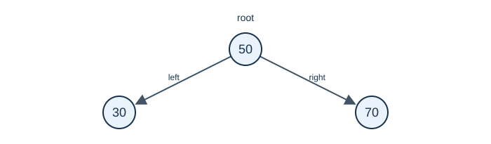
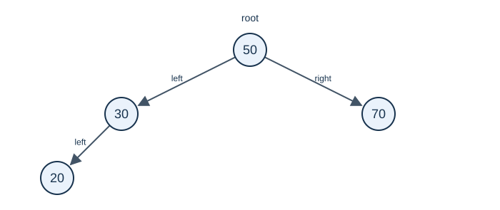
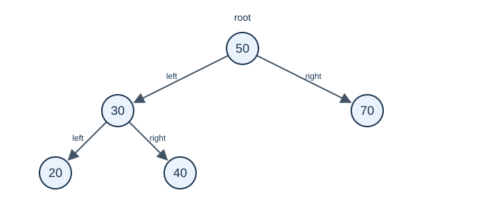
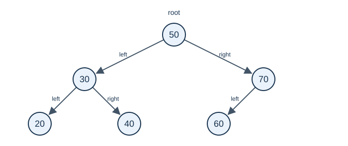
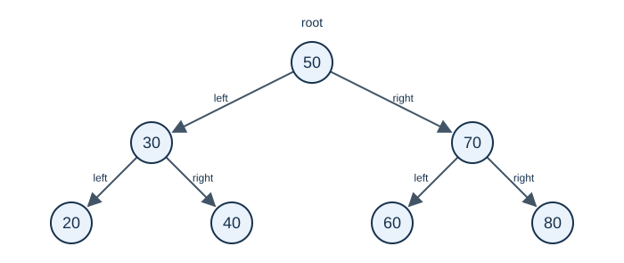
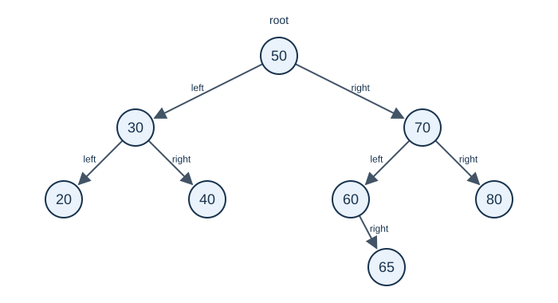
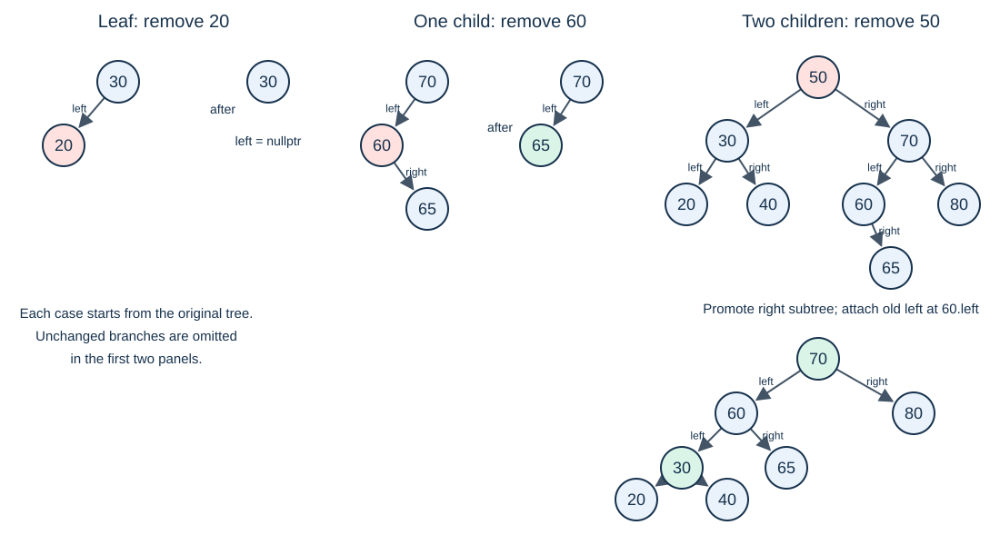
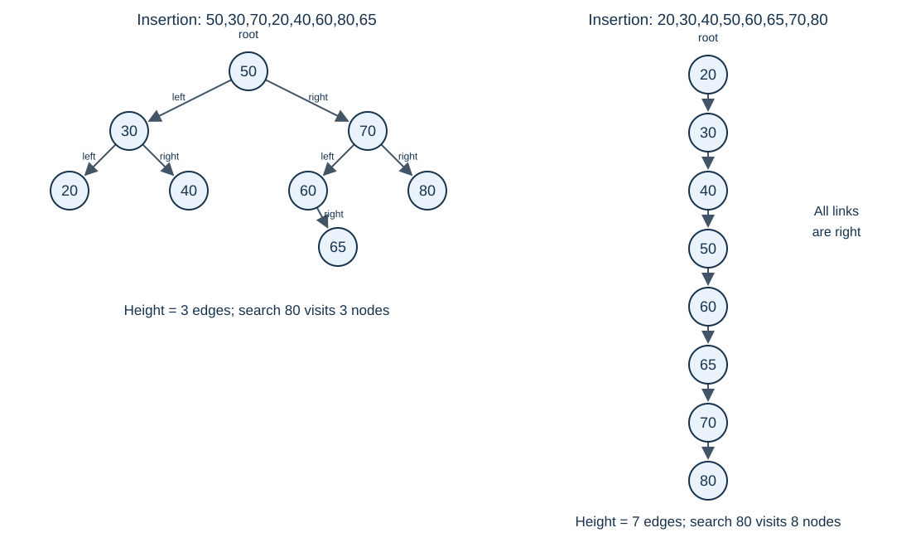
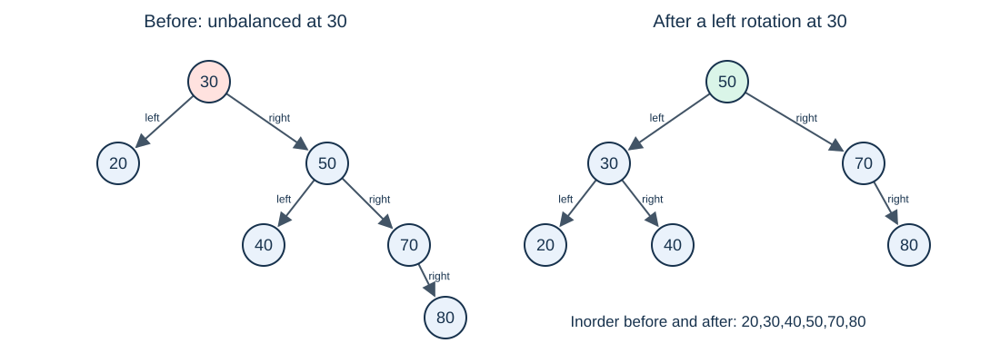

# Semana 13 — Binary Search Trees: operaciones, recorridos y balance
## COEN 2220 — Programming 2

**Instructor:** Wilson Lozano

**Duración:** 120 min de contenido nuevo.  
**Punto de partida:** introducción de la [Semana 12, Parte 6](Semana12_Quicksort_Searching_Binary_Trees.md#parte-6--introducción-a-binary-trees-y-bst), que se retomará antes de esta guía y no se cuenta dentro de estos 120 minutos.  
**Lectura complementaria:** Gaddis, *Starting Out with C++: From Control Structures through Objects*, 8va ed., secciones 20.1–20.2: árboles binarios, representación, inserción, búsqueda, recorridos, eliminación y liberación. La comparación visual de formas balanceadas y la rotación de la Parte 6 son una ampliación conceptual; no implementaremos AVL ni red-black trees.

La guía de Semana 12 presentó qué es un binary tree y qué regla adicional lo convierte en un BST. Allí se definieron `root`, `left`, `right`, parent, leaf, subtree y altura. Retomaremos ese material como introducción; aquí comenzaremos con una necesidad diferente: **construir y mantener el árbol cuando llegan y salen registros**, sin conectar sus nodes manualmente desde `main`.

## Objetivos

Al finalizar la sesión, el estudiante podrá:

1. Representar un BST dinámico dentro de una clase que controle sus enlaces y su memoria.
2. Trazar inserción y búsqueda, identificando el enlace modificado y la llamada que recibe cada resultado.
3. Explicar y ejecutar inorder, preorder y postorder, incluyendo los retornos de los casos base.
4. Eliminar una hoja, un node con un hijo y un node con dos hijos, incluida la root, conservando los demás registros.
5. Relacionar altura con tiempo de operación y explicar gráficamente qué aporta el balance.
6. Liberar todos los nodes mediante postorder y comprobar operaciones sobre un árbol vacío.

## Parte 1 — Del diagrama a una colección administrada por una clase (10 min)

La introducción de Semana 12 mostró nodes con dos enlaces y un pointer de entrada. Sus relaciones estaban preparadas manualmente. Para admitir nuevos datos y retirar otros necesitamos una colección que aplique la regla BST en cada operación. Definiremos esa colección y su propiedad de memoria antes de escribir las funciones que cambian enlaces.

### 1.1 Contexto: un índice de muestras de laboratorio

Un laboratorio universitario conserva muestras físicas identificadas con un número entero único. El personal necesita registrar un ID, verificar si está registrado y retirarlo del índice cuando la muestra deja de estar disponible. También necesita listar todos los IDs existentes para una auditoría.

El programa de esta clase administra **el índice de IDs**, no los resultados de los experimentos ni el almacenamiento físico. Cada node representa una entrada del índice y guarda un `sampleId`. Ese ID identifica la entrada y también es la clave numérica por la cual se organiza el árbol. En los diagramas, `[60]` significa el node cuyo `sampleId` es 60; no significa dirección de memoria ni posición de array.

La clase `SampleIndex` representa el índice completo. Su `struct Node` privado representa una entrada, y su data member `root` conserva la dirección inicial. Cada enlace `left` o `right` señala otro node o vale `nullptr`. La regla es la de un BST con claves únicas: todos los IDs del subárbol izquierdo son menores, y todos los del derecho son mayores, en **cada** node.

Los IDs deben ser únicos porque una consulta o retiro por ID debe identificar una sola muestra. Un intento de insertar un ID ya registrado devolverá `false` y no creará otra entrada. Esta es una decisión del problema; no es una regla universal sobre cómo todo BST debe manejar duplicados.

### 1.2 Qué podrá pedir el programa cliente

`main` será el cliente de `SampleIndex`. Pedirá `insert(id)`, `contains(id)`, `remove(id)`, `display()` y `clear()`. Las tres primeras operaciones devolverán un `bool`: si se agregó, si existe o si se eliminó, respectivamente. `display` mostrará recorridos sin cambiar datos; `clear` retirará todas las entradas. El destructor también liberará lo que quede al terminar la vida del objeto.

> **Nota de lectura:** las secciones iniciales presentan fragmentos de `SampleIndex` por separado para explicar cada responsabilidad antes de combinarla con las demás. El programa ejecutable completo, `sample_bst.cpp`, aparece en la **sección 7.2**. No hay que pegar métodos dentro de `main`.

Este fragmento presenta **solo la representación y el constructor**, dentro de la clase que completaremos.

```cpp
class SampleIndex
{
private:
    struct Node
    {
        int sampleId; // Store the unique ID used by every BST comparison.
        Node *left;
        Node *right;
    };
    Node *root; // Keep the tree entry point private.
public:
    SampleIndex() { root = nullptr; } // No registered samples yet.
};
```

`root = nullptr` significa que no hay primer node; no significa que exista un node con ID cero. Los nodes dinámicos se crearán con `new` al insertar y se liberarán con `delete` al retirar o vaciar. El árbol será su dueño. Un pointer de recorrido podrá consultar esos nodes, pero no adquiere otra propiedad sobre ellos.

No copiaremos objetos `SampleIndex` ni los pasaremos por valor: esta versión no implementa copias independientes de sus nodes. Dos propietarios de las mismas direcciones podrían intentar liberarlas dos veces.

## Parte 2 — Insertar modificando el enlace correcto (20 min)

El constructor deja `root` en `nullptr`: todavía no existe ninguna entrada del índice. Cuando el personal registra una muestra, el programa debe decidir dónde corresponde su ID, crear un node y conectarlo sin perder los anteriores. Desarrollaremos esa operación paso a paso: primero qué decisión tomamos en cada node, después cómo una función puede cambiar un enlace del árbol y finalmente cómo se construyen sus ocho entradas.

### 2.1 Qué debe resolver una inserción

Supongamos que el personal quiere registrar la muestra 30. El programa debe partir de `root` y examinar el lugar donde podría conectarla. Si allí ya existe un node, compara su ID con 30 para decidir por qué lado continuar. Si ese lugar está vacío, puede conectar la nueva muestra. El procedimiento necesita distinguir estas cuatro situaciones:

1. **La entrada está vacía:** ese es el lugar para crear y conectar la nueva muestra. No se necesita desplazar otros nodes.
2. **El ID solicitado es menor que el actual:** continuar en el subárbol izquierdo, donde puede ubicarse sin violar el orden.
3. **El ID solicitado es mayor:** continuar en el derecho.
4. **El ID ya coincide:** rechazar el duplicado, porque cada muestra debe tener una sola entrada.

La condición que permite insertar no es llegar a una hoja existente, sino llegar a **un enlace nulo**, que puede ser `root` en un árbol vacío o uno de los hijos de un node existente. Una hoja ya contiene un ID; una muestra diferente debe conectarse en un enlace disponible, sin reemplazar esa entrada.

### 2.2 Convertir el procedimiento en métodos de la clase

Para programar ese procedimiento dentro de `SampleIndex`, separaremos la solicitud del usuario y el recorrido interno:

- Definiremos un método público llamado **`insert`**, que significa insertar. Recibirá el ID de la muestra que se quiere registrar. Será la operación que podrá solicitar `main` sobre un objeto de la clase. Por ejemplo, si el objeto se llama `samples`, la expresión `samples.insert(30)` le pide registrar el ID 30. El número 30 es un dato del ejemplo; puede sustituirse por otro ID o por una variable que contenga el valor leído por consola.
- Definiremos otro método, privado, llamado **`insertAt`**, que significa insertar a partir de un lugar del árbol. Recibirá el enlace desde el cual debe trabajar y el ID solicitado. Su responsabilidad será ejecutar las cuatro decisiones anteriores: conectar en un enlace vacío, continuar por un hijo o rechazar el duplicado. Es una función de apoyo interna, también llamada *helper*: `main` no la llamará directamente.

Ambos nombres son decisiones de nuestro programa, no instrucciones especiales de C++. Ambos métodos devolverán un `bool`: `true` si lograron registrar la muestra y `false` si el ID ya existía.

Este fragmento es **la definición del método público que agregaremos dentro de `SampleIndex`**. El parámetro `int id` recibe el ID solicitado. La llamada a `insertAt` comienza en `root`, porque el recorrido debe considerar el árbol completo. El `return` entrega a quien llamó a `insert` el resultado que produzca ese trabajo interno.

```cpp
bool insert(int id)
{
    return insertAt(root, id); // Start at the tree entry point and report the result.
}
```

Para una solicitud `samples.insert(30)`, el parámetro `id` vale 30 y el método público solicita `insertAt(root, 30)`. Si este último encuentra el node 50, pedirá continuar desde su enlace izquierdo. Esa nueva llamada realizará las mismas decisiones sobre un subárbol más pequeño: esa repetición del propio método es la recursión que utilizaremos.

Todavía falta resolver cómo `insertAt` podrá cambiar un enlace del árbol cuando encuentre el lugar vacío. No basta con localizarlo: la dirección del nuevo node tiene que quedar guardada en el `root`, `left` o `right` correspondiente. Antes de escribir el cuerpo de ese método, estudiaremos qué debe recibir su parámetro para que esa asignación tenga efecto en el árbol.

### 2.3 De cambiar `head` directamente a recibir un pointer por referencia

En la lista de turnos de Registraduría de Semana 9, el método `addRegularTurn` agregaba un node al final. Si la lista estaba vacía, ejecutaba `head = newNode`. Ese método pertenecía a la clase y cambiaba directamente su member `head`. Para conectar el primer node de nuestro árbol podríamos hacer lo mismo: asignar su dirección directamente a `root`.

Lo nuevo es que queremos delegar la conexión a un **helper**. Ya sabemos usar un pointer para acceder al node al que señala. Ahora necesitamos que el helper cambie **la dirección guardada en el propio pointer**, para conectarlo a un node. Ese pointer puede ser `root`, `left` o `right`. Primero distinguiremos modificar un node de cambiar un pointer; después veremos cómo recibir ese pointer por referencia permite al helper cambiar la variable original.

Los fragmentos de esta sección formarán un programa independiente de demostración, `pointer_reference_demo.cpp`, que veremos completo en la **sección 2.4**. En ese programa, `main` contendrá las variables y llamadas de prueba; no es todavía el `main` del BST integrado de la sección 7.2.

#### 2.3.1 La tarea que ya conocemos: conectar un node

En esta demostración, `node50` será un objeto local de tipo `Node` con ID 50 y dos hijos nulos. `root` será el pointer de entrada. Este fragmento se ubica dentro de `main`; muestra una conexión directa, sin helper:

```cpp
Node node50 = {50, nullptr, nullptr}; // A node that already exists.
Node *root = nullptr;               // No node is connected yet.
root = &node50;                      // Connect the tree entry point.
```

Después de la asignación, `root` señala a `node50`. El `&` de `&node50` obtiene la dirección del objeto que queremos conectar, no su ID.

Antes de introducir el helper, hagamos una prueba corta dentro de `main`, después de esa conexión. Crearemos otra variable pointer llamada `branch` y copiaremos en ella la dirección que guarda `root`:

```cpp
Node *branch = root; // Two distinct pointers now store the same node address.
```

Ahora hay **dos variables pointer distintas y un solo node**. Las flechas del esquema representan la dirección guardada en cada pointer; ambas llevan al mismo objeto:

```text
root   ──┐
         ├──► node50 [sampleId: 50]
branch ──┘
```

Veamos dos instrucciones consecutivas que hacen cosas diferentes. La primera usa `branch` para llegar al node y cambiar su ID; la segunda cambia únicamente la dirección guardada en `branch`:

```cpp
branch->sampleId = 55; // Change the node shared by both pointers.
branch = nullptr;     // Disconnect only this local pointer.
```

Después de la primera instrucción, consultar `root->sampleId` también da 55: ambos pointers permiten acceder al mismo objeto. Después de la segunda, `root` sigue señalando a ese objeto, pero `branch` ya no señala ningún node. El objeto conserva el nombre `node50` aunque hayamos cambiado su ID en esta prueba:

```text
root   ─────► node50 [sampleId: 55]
branch ─────► nullptr
```

**Guardar una dirección permite acceder a un objeto; no convierte dos variables pointer en una sola variable.** Por eso podemos modificar el node compartido mediante una copia del pointer, pero cambiar esa copia no cambia el pointer original.

Para continuar con las pruebas de conexión, restauramos el ID del objeto dentro de `main`. Este cambio es solo parte de la demostración; insertar muestras en el BST no modificará IDs existentes:

```cpp
node50.sampleId = 50; // Restore the original ID for the connection examples.
```

Ahora intentaremos delegar a un helper la asignación que conecta `root` con ese objeto.

#### 2.3.2 Recibir el pointer por valor no permite reemplazar el original

Definiremos un helper llamado `connectCopy`. Su primer parámetro, `branch`, recibirá el pointer que queremos cambiar; el segundo, `added`, recibirá la dirección del node que queremos conectar. Este fragmento muestra la función, que se define **antes de `main`**:

```cpp
void connectCopy(Node *branch, Node *added)
{
    branch = added; // Change only this local pointer.
}
```

Para probarla, empezamos otra vez con `root` nulo. Dentro de `main`, la llamada sería:

```cpp
root = nullptr;                   // Restart with an empty entry point.
connectCopy(root, &node50);        // branch receives the value stored in root.
// root is still nullptr after this call.
```

El primer argumento es `root`, por eso el parámetro `branch` recibe su valor: `nullptr`. Pero son **dos variables distintas**. La asignación `branch = added` cambia únicamente `branch`; nunca asigna un valor a `root`. No se copia el node: se copia el valor del pointer.

#### 2.3.3 Recibir el pointer por referencia sí permite cambiar el original

Definiremos otro helper, `connectReference`, con la misma tarea. La diferencia está en **`Node *&branch`**: el `*` indica un pointer a `Node` y el `&` indica que lo recibimos por referencia. **Recibir el pointer por referencia significa que el parámetro será otro nombre para la variable pointer original**, en lugar de ser un segundo pointer independiente. Por tanto, asignar una dirección al parámetro cambiará la dirección guardada en esa variable original. Esta función también se define antes de `main`:

```cpp
void connectReference(Node *&branch, Node *added)
{
    branch = added; // Change the caller's pointer through its reference.
}
```

Dentro de `main`, entregamos `root` como primer argumento. No añadimos `&` delante de `root`: el paso por referencia ya está establecido en el parámetro de la función.

```cpp
connectReference(root, &node50);   // branch refers to the actual root variable.
// root now points to node50.
```

Esta vez, `branch = added` cambia **`root`**, porque `branch` es su referencia. Al regresar a `main`, `root` conserva la dirección de `node50`.

> **¿Podríamos pasar `&root` como argumento?** Sí, con otra declaración de la función: `&root` es la dirección de una variable pointer y requiere un parámetro de tipo `Node **`. No podemos sustituir `root` por `&root` en las funciones anteriores, porque sus tipos no corresponden. Aquí usaremos `Node *&branch`, la alternativa por referencia que también emplea el libro.

#### 2.3.4 El mismo helper puede conectar un hijo

Una vez que `root` señala a `node50`, podemos conectar a su izquierda otro objeto local, `node30`, cuyo ID es 30. Este fragmento continúa dentro de `main`:

```cpp
Node node30 = {30, nullptr, nullptr}; // Another node to connect.
connectReference(root->left, &node30); // Change node50's left pointer.
```

Ahora el primer argumento es `root->left`. Por tanto, `branch` representa **ese member `left`**, y la asignación cambia el enlace izquierdo de 50. `root` continúa señalando a 50; su hijo izquierdo señala a 30. Solo podemos usar `root->left` porque ya conectamos `root`: no sería válido acceder a ese member si `root` todavía fuera `nullptr`.

Esa es la utilidad para nuestro BST: cada llamada al helper de inserción recibirá por referencia **el enlace específico que debe poder modificar**, sin necesitar una función diferente para `root`, `left` y `right`.

### 2.4 Un programa corto para observar la diferencia

El programa completo permite comprobar las llamadas que acabamos de explicar. Las dos funciones realizan **la misma asignación**, `branch = added`; lo que cambia es si el primer parámetro es una copia independiente o una referencia a la variable del llamador.

Este es un **programa independiente completo**, `pointer_reference_demo.cpp`. Usa un `struct Node` con los mismos tres campos de la representación anterior, declarado fuera de una clase para aislar la demostración. `node50` y `node30` son objetos locales; las llaves inicializan ID, hijo izquierdo e hijo derecho, en ese orden. No hay `new` ni corresponde `delete` en esta prueba. El BST dinámico de la Parte 7 seguirá siendo otro programa, `sample_bst.cpp`.

```cpp
#include <iostream>
using namespace std;

struct Node
{
    int sampleId; // Identify the local node used in this pointer experiment.
    Node *left;
    Node *right;
};

void connectCopy(Node *branch, Node *added)
{
    branch = added; // Change this local copy, not the caller's pointer variable.
}

void connectReference(Node *&branch, Node *added)
{
    branch = added; // Change the actual pointer variable supplied by the caller.
}

int main()
{
    Node node50 = {50, nullptr, nullptr};
    Node node30 = {30, nullptr, nullptr};
    Node *root = nullptr; // The entry point has not been connected yet.
    cout << boolalpha;

    connectCopy(root, &node50);
    cout << "Root empty after copy call: " << (root == nullptr) << '\n';

    connectReference(root, &node50);
    cout << "Root ID after reference call: " << root->sampleId << '\n';

    connectCopy(root->left, &node30);
    cout << "Left empty after copy call: " << (root->left == nullptr) << '\n';

    connectReference(root->left, &node30);
    cout << "Left ID after reference call: " << root->left->sampleId << '\n';
    cout << "Root ID is still: " << root->sampleId << '\n';
    return 0; // Local objects remain alive throughout these calls and accesses.
}
```

Para comprobar esta diferencia, compila el archivo independiente:

```bash
g++ pointer_reference_demo.cpp -o pointer_reference_demo
```

Luego ejecútalo:

```bash
./pointer_reference_demo
```

El output debe mostrar que las llamadas por copia no conectaron el enlace del llamador, mientras las llamadas por referencia sí lo hicieron:

```text
Root empty after copy call: true
Root ID after reference call: 50
Left empty after copy call: true
Left ID after reference call: 30
Root ID is still: 50
```

Las dos primeras líneas del output contrastan el resultado sobre `root`: la copia lo dejó nulo y la referencia lo conectó a 50. Las dos siguientes hacen la misma prueba sobre el enlace izquierdo. La última confirma que conectar ese hijo no reemplazó la entrada del árbol.

**Recibir un pointer por valor sí permite usarlo para consultar o modificar el node señalado**, siempre que la dirección sea válida. Por ejemplo, `branch->sampleId = 55` cambiaría el ID de ese node. Eso es distinto de `branch = added`, que reemplaza el valor del pointer local. Para insertar queremos cambiar un enlace, no modificar el ID de una muestra existente; por eso el helper recibe ese enlace por referencia.

### 2.5 Aplicar esa referencia al helper de inserción

Volvamos a la clase `SampleIndex`. `insertAt(Node *&branch, int id)` recibirá una referencia al enlace que está examinando y el ID solicitado. En la primera llamada ese enlace será `root`. Cuando decida continuar por la izquierda o derecha, entregará el member de ese node a la llamada siguiente.

Este fragmento es el **helper completo dentro de `SampleIndex`**. Sigue las cuatro decisiones presentadas al inicio. Crea el node solo al encontrar un enlace nulo; así un duplicado no deja una reserva de memoria sin utilizar.

```cpp
bool insertAt(Node *&branch, int id)
{
    if (branch == nullptr)
    {
        Node *added = new Node;
        added->sampleId = id;
        added->left = nullptr;
        added->right = nullptr;
        branch = added; // Update the actual root or child pointer received.
        return true;
    }
    if (id < branch->sampleId) return insertAt(branch->left, id);
    if (id > branch->sampleId) return insertAt(branch->right, id);
    return false; // Equality means this unique ID was already registered.
}
```

Cada llamada resuelve una de tres posibilidades: encontró el enlace vacío, debe continuar por un hijo, o encontró un duplicado. Los dos hijos nuevos comienzan nulos porque todavía no tienen descendientes. No se cambia ningún ID existente para acomodar el nuevo dato.

### 2.6 Construir el árbol después de cada inserción

Usaremos la secuencia controlada `50, 30, 70, 20, 40, 60, 80, 65`. Son IDs dummy para comparar trazas; el programa integrado de la **sección 7.2** permitirá registrar otros por consola. El primer ID recibido determina la root inicial: el algoritmo no calcula una mediana antes de comenzar.

Cada gráfico muestra **el árbol completo después de una inserción**, conservando las posiciones visuales de los nodes anteriores. Cada círculo representa un node y el número es su `sampleId`; las flechas son enlaces `left` o `right`, no llamadas de funciones. Se omiten los hijos nulos. Los nombres como `node50.left` en el texto identifican el member del node 50; no implican variables adicionales en el BST dinámico.

Antes de la primera inserción solo existe la variable de entrada, cuyo valor es nulo:

```text
root -> nullptr
Registered nodes: 0
```

#### 2.6.1 Inserción 1: registrar 50 en un árbol vacío

Cuando el programa integrado de la **sección 7.2** solicite `samples.insert(50)`, el método público llamará a `insertAt(root, 50)`. La condición `branch == nullptr` será verdadera porque `branch` representa `root`. La función creará el node con ID 50 y dos hijos nulos; `branch = added` cambiará **root** a la nueva dirección y devolverá `true`.

Este es el primer estado conectado; todavía no hubo comparación entre IDs porque no existía otro node:


El cambio fue `root: nullptr -> dirección de node50`. Queda un node; `node50.left` y `node50.right` siguen nulos.

#### 2.6.2 Inserción 2: registrar 30 a la izquierda de 50

`insertAt(root, 30)` encuentra 50: `30 < 50` es verdadero. Solicita `insertAt(node50.left, 30)`. En esa llamada, `branch` representa el enlace izquierdo de 50, que vale `nullptr`. Se crea 30, se conecta ese enlace y se retorna `true` a la llamada de 50; esta devuelve el resultado al método público y luego al cliente que solicitó la inserción.

El gráfico añade 30 sin reemplazar el punto de entrada:


El cambio fue `node50.left: nullptr -> dirección de node30`. Quedan dos nodes; `root` conserva la dirección de 50 y el lado derecho de 50 sigue vacío.

#### 2.6.3 Inserción 3: registrar 70 a la derecha de 50

En 50, `70 < 50` es falso y `70 > 50` es verdadero. La llamada siguiente recibe `node50.right`. Como ese enlace es nulo, crea 70 y lo conecta allí. El enlace hacia 30 permanece intacto.

Ahora ambos lados de la root contienen un node:



El cambio fue `node50.right: nullptr -> dirección de node70`. Quedan tres nodes y las llamadas retornan `true` por la ruta que las inició.

#### 2.6.4 Inserción 4: registrar 20 bajo 30

La primera comparación, `20 < 50`, conduce a 30. Todavía no podemos insertar: ese enlace ya tiene un node. La comparación siguiente, `20 < 30`, conduce a `node30.left`. Solo esa tercera llamada encuentra un enlace nulo y crea 20.

El gráfico muestra por qué estar a la izquierda de 50 no significa ser su hijo directo:



El cambio fue `node30.left: nullptr -> dirección de node20`. Quedan cuatro nodes. El resultado vuelve primero a la llamada que examinó 30 y luego a la que examinó 50; `root` no cambia.

#### 2.6.5 Inserción 5: registrar 40 sin alterar el enlace de 20

`40 < 50` conduce a 30. Allí `40 < 30` es falso y `40 > 30` es verdadero, de modo que se solicita el lado derecho de 30. `node30.right` está nulo y recibe el nuevo node 40.

El nuevo ID queda entre su padre y su antecesor: es mayor que 30, pero sigue siendo menor que 50:



El cambio fue `node30.right: nullptr -> dirección de node40`. Quedan cinco nodes; el enlace izquierdo de 30 todavía señala 20. No se intercambiaron IDs para conseguir esa posición.

#### 2.6.6 Inserción 6: registrar 60 dentro de la derecha de 50

En 50, la condición menor es falsa y `60 > 50` es verdadera: se continúa en 70. En 70, `60 < 70` es verdadero: se solicita `node70.left`, que es nulo. Ese es el enlace que recibe 60.

El gráfico conserva completo el subárbol de 30 y añade el nuevo node bajo 70:



El cambio fue `node70.left: nullptr -> dirección de node60`. Quedan seis nodes. 60 pertenece a la derecha de 50 y a la izquierda de 70; debe cumplir ambas relaciones.

#### 2.6.7 Inserción 7: registrar 80 a la derecha de 70

Las comparaciones `80 > 50` y `80 > 70` conducen a `node70.right`. La llamada sobre ese enlace nulo crea 80; los nodes 30 y 60 no se modifican.

Este es el estado previo a la inserción más profunda de nuestra secuencia:



El cambio fue `node70.right: nullptr -> dirección de node80`. Quedan siete nodes; 60 aún no tiene hijos.

#### 2.6.8 Inserción 8: registrar 65 como hijo de 60

La ruta exige tres decisiones: `65 > 50`, `65 < 70` y `65 > 60`. El enlace `node60.right` está nulo; allí se crea 65, con sus propios hijos nulos. La llamada que conecta ese enlace devuelve `true` a la de 60, después a la de 70 y finalmente a la de 50.

El gráfico final, que utilizaremos para búsqueda, recorridos y eliminación, incorpora el octavo node:



El cambio fue `node60.right: nullptr -> dirección de node65`. Quedan ocho nodes. En cada inserción se creó un solo node y se sustituyó un solo enlace nulo; no se reasignaron los enlaces usados para llegar hasta él.

Para observar una ruta más larga, sigamos **la última inserción, 65**, cuando ya existen los otros siete IDs. En el programa integrado de la sección 7.2, esa solicitud vendrá de `main`; aquí la llamaremos simplemente el cliente. La indentación siguiente indica llamadas anidadas, no enlaces del árbol. `branch aliases` identifica qué variable pointer está representando el parámetro por referencia en cada llamada.

```text
client -> insert(65) -> insertAt(root, 65)
    branch aliases root; it points to 50
    65 < 50: false; 65 > 50: true -> call using node50.right
        branch aliases node50.right; it points to 70
        65 < 70: true -> call using node70.left
            branch aliases node70.left; it points to 60
            65 < 60: false; 65 > 60: true -> call using node60.right
                branch aliases node60.right; value is nullptr
                create node65 with left=nullptr and right=nullptr
                node60.right = address of node65 -> return true
            resume call at 60 -> return true
        resume call at 70 -> return true
    resume call at 50 -> return true
insert(65) returns true -> client receives insertion success
```

La llamada inicial no reasigna `root` para avanzar por la ruta. Cada llamada nueva recibe **otro enlace**. El único enlace que cambia al agregar 65 es `node60.right`; las llamadas pendientes solo propagan `true`.

Si se vuelve a insertar 65, la ruta llega al node existente. Allí ambas comparaciones estrictas son falsas y se devuelve `false`. No se ejecutó `new`, no cambió un enlace y no hay un node sobrante por liberar.

<details>
<summary>Práctica resuelta: ¿dónde se insertaría 55 y qué variable pointer cambiaría?</summary>

La ruta de decisión es 50, 70, 60. Como 55 es menor que 60, la llamada siguiente recibe `node60.left`, que vale `nullptr`. Ese enlace se conecta con el nuevo 55. `root` sigue señalando 50 y `node60.right` sigue señalando 65.

</details>

## Parte 3 — Buscar sin modificar el árbol (10 min)

Insertar ya nos obligó a comparar un ID y elegir una rama. Para consultar si una muestra está registrada no debemos crear nodes ni cambiar esos enlaces. Usaremos un pointer local y un loop; su resultado también nos ayudará a entender cómo localizar el node que luego queramos eliminar.

### 3.1 Qué cambia durante la búsqueda

El personal necesita saber si la muestra 65 está registrada. En el programa integrado de la **sección 7.2**, `main` solicitará esa consulta con `samples.contains(65)`. Su método público `contains` recibirá 65 en el parámetro `id` y devolverá un `bool`, que el cliente usará para mostrar si encontró la muestra.

La búsqueda comienza con `Node *current = root`, porque debe considerar el árbol completo. Como en la prueba de los dos pointers de la Parte 2, **`current` y `root` son variables distintas que inicialmente señalan al mismo node**. No queremos cambiar la entrada del árbol, por eso aquí no necesitamos una referencia al pointer.

El ID objetivo permanece fijo; solo cambia la dirección guardada en `current`. Para buscar 65, la primera comparación de igualdad con 50 resulta falsa. Luego `65 < 50` también resulta falsa, así que ejecutamos `current = current->right`. El esquema muestra las direcciones antes y después; las flechas representan pointers, no llamadas:

```text
Before advancing:
    target = 65
    root    -> node50
    current -> node50
    node50.right -> node70

After current = current->right:
    target = 65
    root    -> node50
    current -> node70
    node50.right -> node70 (unchanged)
```

Descartamos la izquierda de 50 porque allí todos los IDs son menores que 50 y ninguno puede ser 65. El enlace derecho no cambió: solo copiamos su dirección en `current`. La siguiente vuelta del loop comparará 65 con 70. Si el objetivo es menor que el ID actual, el mismo razonamiento permite descartar la derecha y continuar por la izquierda.

El fragmento siguiente es **el método público completo dentro de la clase**. Devuelve `true` al coincidir o `false` cuando la única ruta posible termina en un enlace nulo.

```cpp
bool contains(int id) const
{
    Node *current = root; // Move a local pointer; preserve the tree entry point.
    while (current != nullptr)
    {
        if (id == current->sampleId) return true;
        if (id < current->sampleId) current = current->left;
        else current = current->right;
    }
    return false; // No node remains on the route where this ID could exist.
}
```

Para buscar 65 en el árbol original, los estados son los siguientes. Cada fila textual conserva objetivo, node actual, decisión y destino. Las flechas de esta traza indican avance de `current` por enlaces ya existentes.

```text
Target: 65 | Current: 50 | Match: false | Decision: 65 > 50 | Next: right -> 70
Target: 65 | Current: 70 | Match: false | Decision: 65 < 70 | Next: left  -> 60
Target: 65 | Current: 60 | Match: false | Decision: 65 > 60 | Next: right -> 65
Target: 65 | Current: 65 | Match: true  | Decision: return true | Next: client
```

Para buscar 55, las decisiones iniciales son similares, pero la última rama no tiene un node. Estos son todos los estados de esa consulta:

```text
Target: 55 | Current: 50      | Match: false | Decision: 55 > 50 | Next: right -> 70
Target: 55 | Current: 70      | Match: false | Decision: 55 < 70 | Next: left  -> 60
Target: 55 | Current: 60      | Match: false | Decision: 55 < 60 | Next: left  -> nullptr
Target: 55 | Current: nullptr | Match: not evaluated | Decision: loop stops, return false | Next: client
```

No se consulta `current->sampleId` cuando `current` es nulo: la condición del loop lo comprueba antes. Una hoja existente todavía debe compararse; que sus hijos sean nulos no significa que su propio ID esté ausente.

La cantidad de nodes visitados depende de la altura y de dónde aparezca el objetivo. No necesariamente se visita medio árbol: se sigue una sola ruta, cuya longitud puede ser casi la del árbol completo si su forma es una cadena.

## Parte 4 — Recorrer todos los nodes y entender los retornos (20 min)

La búsqueda selecciona una ruta porque conoce un ID objetivo. Para auditar todos los IDs necesitamos visitar **ambas ramas** de cada node existente. Los recorridos definirán en qué momento procesamos al padre respecto de sus hijos; postorder también preparará la liberación de memoria del cierre.

### 4.1 Visitar y procesar no significan lo mismo

En esta clase, **procesar** un node significa imprimir su ID. La función puede llegar al padre y dejar su impresión pendiente mientras procesa un subárbol. Por eso no basta mirar qué llamada comienza primero para deducir qué ID se imprime primero.

Cada helper recibe `Node *current`, una copia de la dirección de entrada de un subárbol. Recibirla por valor es suficiente: queremos leer los nodes e imprimir sus IDs, sin cambiar `root`, `left` ni `right`. Cada llamada recursiva tendrá su propio `current`; cuando termine, la llamada del padre conservará el suyo. Si recibe `nullptr`, retorna sin imprimir. Si recibe un node, programa trabajo para su rama izquierda y derecha, además de la impresión propia. Las dos ramas se ejecutan **sucesivamente**, no en paralelo.

La tabla resume dónde se ubica la impresión respecto de esas llamadas. Se aplica en cada subárbol, no solo en la root.

| Recorrido | Secuencia de acciones | Utilidad en este índice |
| --- | --- | --- |
| Inorder | Izquierda, imprimir actual, derecha. | Listar IDs ascendentes porque el árbol cumple la regla BST. |
| Preorder | Imprimir actual, izquierda, derecha. | Inspeccionar la entrada de cada subárbol antes de sus descendientes. |
| Postorder | Izquierda, derecha, imprimir actual. | Preparar el principio de liberar descendientes antes que su padre. |

Definiremos tres helpers privados: `showInOrder` ejecutará inorder, `showPreOrder` ejecutará preorder y `showPostOrder` ejecutará postorder. Ninguno devuelve un valor: su resultado observable es la impresión de IDs.

En el programa integrado que presentaremos en la **sección 7.2**, `main` creará el objeto `samples` y solicitará `samples.display()`. Ese método público solicitará primero `showInOrder(root)` y esperará a que termine **todo** ese recorrido. Después solicitará `showPreOrder(root)` y, cuando este termine, `showPostOrder(root)`. Con los ocho IDs iniciales del programa, cada helper recibirá primero la dirección del node 50. Las definiciones completas siguientes van dentro de la zona privada de `SampleIndex`; el método público que las llama aparecerá integrado en la sección 7.2.

```cpp
void showInOrder(Node *current) const
{
    if (current == nullptr) return; // Empty subtree: no output and no child access.
    showInOrder(current->left);
    cout << current->sampleId << ' ';
    showInOrder(current->right);
}

void showPreOrder(Node *current) const
{
    if (current == nullptr) return;
    cout << current->sampleId << ' '; // Print before asking either child to work.
    showPreOrder(current->left);
    showPreOrder(current->right);
}

void showPostOrder(Node *current) const
{
    if (current == nullptr) return;
    showPostOrder(current->left);
    showPostOrder(current->right);
    cout << current->sampleId << ' '; // Print only after both calls return.
}
```

### 4.2 Seguir una rama hasta sus casos base y volver

Sigamos la llamada `showInOrder(root)` que solicita `display`. En el árbol original, `root` señala a 50. Los nombres `node50`, `node30` y los demás identifican la dirección del node con ese ID; no son variables adicionales del programa. La indentación representa qué llamada solicita otra. Las líneas `resume` muestran dónde continúa el padre después de que termina el hijo.

Esta traza completa sigue los ocho nodes y también las llamadas con `nullptr`. Cada una de estas últimas cumple el caso base y regresa a quien la llamó; no termina el recorrido completo:

```text
display calls showInOrder(node50): ask left; printing 50 must wait
    showInOrder(node30): ask left; printing 30 must wait
        showInOrder(node20): ask left; printing 20 must wait
            showInOrder(nullptr): return to node20
        resume at node20: print 20; ask right
            showInOrder(nullptr): return to node20
        resume at node20: finished -> return to node30
    resume at node30: print 30; ask right
        showInOrder(node40): ask left; printing 40 must wait
            showInOrder(nullptr): return to node40
        resume at node40: print 40; ask right
            showInOrder(nullptr): return to node40
        resume at node40: finished -> return to node30
    resume at node30: finished -> return to node50
resume at node50: print 50; ask right
    showInOrder(node70): ask left; printing 70 must wait
        showInOrder(node60): ask left; printing 60 must wait
            showInOrder(nullptr): return to node60
        resume at node60: print 60; ask right
            showInOrder(node65): ask left; printing 65 must wait
                showInOrder(nullptr): return to node65
            resume at node65: print 65; ask right
                showInOrder(nullptr): return to node65
            resume at node65: finished -> return to node60
        resume at node60: finished -> return to node70
    resume at node70: print 70; ask right
        showInOrder(node80): ask left; printing 80 must wait
            showInOrder(nullptr): return to node80
        resume at node80: print 80; ask right
            showInOrder(nullptr): return to node80
        resume at node80: finished -> return to node70
    resume at node70: finished -> return to node50
resume at node50: finished -> return to display
display prints a newline, then calls showPreOrder(root)
```

La rama de 30 produce `20 30 40`. Al regresar a la llamada de 50, su pointer local todavía señala a 50: las llamadas hijas no lo movieron. Por eso puede imprimir 50 y pedir su rama derecha. No se combinan arrays ni se reconectan nodes al retornar; los IDs se van imprimiendo en el orden de las instrucciones.

En **preorder**, 30 se imprime antes de solicitar 20, así que ese subárbol produce `30 20 40`. En **postorder**, la llamada de 30 deja pendiente su impresión hasta que regrese también 40, y produce `20 40 30`.

Sobre los ocho nodes originales, las secuencias completas esperadas son estas. Cada línea corresponde a un recorrido independiente que vuelve a comenzar en la misma root; ninguno reordena el árbol.

```text
Inorder: 20 30 40 50 60 65 70 80
Preorder: 50 30 20 40 70 60 65 80
Postorder: 20 40 30 65 60 80 70 50
```

Inorder produce orden ascendente **por la regla BST**. Un binary tree general también admite esos tres recorridos, pero su inorder no tiene por qué ordenar sus datos. Tampoco es suficiente guardar solo una secuencia preorder para describir inequívocamente cualquier binary tree sin información de su estructura.

Cada recorrido visita todos los nodes: tiempo `O(n)`. La memoria auxiliar depende de las llamadas activas simultáneas, no del total de llamadas realizadas: `O(h + 1)`, con `h` medido en enlaces. En un árbol balanceado es `O(log n)` y en una cadena puede ser `O(n)`.

<details>
<summary>Práctica resuelta: ¿cuándo imprime postorder el ID 60 si su hijo derecho es 65?</summary>

Primero la llamada izquierda de 60 recibe `nullptr` y retorna. Luego la llamada derecha procesa 65: sus dos hijos nulos retornan y se imprime 65. Esa llamada termina; recién entonces la llamada de 60 imprime 60. Por eso aparece `65 60`, aunque 60 se visitó antes al iniciar ese subárbol.

</details>

## Parte 5 — Eliminar sin perder los subárboles (35 min)

Ya podemos localizar un ID y visitar sus descendientes. Retirar una muestra exige algo más: cambiar el enlace que apuntaba a su node y liberar esa memoria, conservando todos los demás IDs. Separaremos la búsqueda del lugar y la reconexión; usaremos nuevamente una referencia al pointer para que funcione también cuando se elimina la root.

### 5.1 Localizar no equivale a liberar

Supongamos que el personal retira la muestra 60. En el programa integrado de la **sección 7.2**, `main` solicitará `samples.remove(60)` para eliminar su entrada del índice. Separaremos ese trabajo en dos helpers privados:

- **`removeAt` localiza el ID.** Recibe el enlace de entrada del subárbol y el ID solicitado. Devuelve `false` si no existe y `true` si logró retirarlo.
- **`unlinkRoot` reconecta y libera el node encontrado.** Recibe por referencia el enlace que lo señala. No busca un ID ni devuelve un valor; cambia ese enlace y libera un solo node.

El nombre `unlinkRoot` se refiere a retirar la entrada **del subárbol recibido**, no necesariamente la root del árbol completo. Para retirar 60, esa entrada será el member `left` del node 70.

El método público `remove` inicia el trabajo con `removeAt(root, 60)`. Al comparar con 50, el helper solicita `removeAt(node50.right, 60)`; al encontrar 70, solicita `removeAt(node70.left, 60)`. Esa última llamada encuentra el ID y pide `unlinkRoot(branch)`. Como `branch` es una referencia a `node70.left`, el segundo helper podrá cambiar ese mismo enlace. Es la aplicación de recibir un pointer por referencia que practicamos al insertar.

Si `removeAt` recibe un enlace nulo, retorna `false` antes de consultar un ID. Si el node existe pero no coincide, continúa por el hijo determinado por la regla BST.

Este helper privado completo ubica la entrada y devuelve éxito o ausencia. `unlinkRoot`, explicado a continuación, modifica el enlace recibido y no devuelve una dirección.

```cpp
bool removeAt(Node *&branch, int id)
{
    if (branch == nullptr) return false; // Check absence before reading a member.
    if (id < branch->sampleId) return removeAt(branch->left, id);
    if (id > branch->sampleId) return removeAt(branch->right, id);
    unlinkRoot(branch); // The matching entry exists and can now be reconnected.
    return true;
}
```

El `bool` indica si se retiró un ID. El cambio de dirección ocurre mediante `branch`, no mediante ese valor de retorno. Si no existe el objetivo, la llamada que llega a `nullptr` retorna `false` y las anteriores lo propagan sin modificar enlaces ni ejecutar `delete`.

El gráfico siguiente muestra **tres casos independientes que parten del árbol original**. En los dos primeros paneles se omiten ramas que no cambian. El panel de dos hijos muestra el árbol completo antes y después; el rojo identifica el node que se retirará y el verde destaca conexiones resultantes.



### 5.2 Caso 1: retirar una hoja

En el árbol original, 20 tiene `left = nullptr` y `right = nullptr`. La búsqueda sigue 50, después 30 y finalmente 20. En la llamada que coincide, `branch` es una referencia a `node30.left`.

Guardamos la dirección de 20 en `removed`. Como no tiene hijo derecho, asignamos a `branch` su hijo izquierdo, que también es nulo. La secuencia concreta es:

```text
Before: node30.left -> node20; node20.left=nullptr; node20.right=nullptr
Save:   removed = address of node20
Relink: node30.left = node20.left = nullptr
Free:   delete removed
After:  node30.left = nullptr; ID20 no longer has a node
```

`removed` conserva la dirección que debe liberarse aunque el enlace del padre ya no la guarde. Sin esa conservación, después de poner `node30.left` nulo habríamos perdido la dirección necesaria para `delete`.

### 5.3 Caso 2: retirar un node con un hijo

En otra ejecución desde los ocho IDs originales, 60 tiene un hijo derecho, 65, y no tiene izquierdo. La ruta de búsqueda es 50, 70, 60. En la coincidencia, `branch` representa `node70.left`.

El padre debe pasar a señalar 65. Los datos de 65 no se copian sobre 60: se cambia una dirección y se libera únicamente el node 60.

```text
Before: node70.left -> node60; node60.left=nullptr; node60.right -> node65
Save:   removed = address of node60
Relink: node70.left = node60.right = address of node65
Free:   delete removed
After:  node70.left -> node65; ID65 and its descendants remain reachable
```

El caso espejo también debe funcionar. Si el hijo derecho es nulo y el izquierdo existe, el enlace recibido adopta la dirección del izquierdo. La misma rama del código cubre la hoja: adoptar un hijo izquierdo nulo deja el enlace vacío.

### 5.4 Caso 3: retirar un node con dos hijos

Volvamos al árbol original y retiremos 50. Su izquierda comienza en 30; su derecha comienza en 70. No podemos simplemente borrar 50 y perder ambas direcciones, ni guardar dos subárboles en el único pointer `root`.

Seguiremos la estrategia de la sección 20.2 del libro: **promover todo el subárbol derecho y conectar el izquierdo al node más a la izquierda de ese subárbol derecho**. Aquí se promueve 70. No estamos copiando el ID de un sucesor sobre 50 ni promoviendo directamente el mínimo 60.

`firstInRight` será un pointer local de recorrido. Comienza en 70 porque buscamos dentro del subárbol derecho. Sigue `left` hasta encontrar un node cuyo `left` es nulo; en estos datos llega a 60. Ese enlace libre será la conexión para la antigua izquierda de 50.

Los estados siguientes muestran todos los cambios de esa eliminación. Las flechas indican direcciones guardadas; `branch` es una referencia a `root` en este caso.

```text
Before:
    branch aliases root -> node50
    node50.left -> node30; node50.right -> node70
    node70.left -> node60; node60.left=nullptr; node60.right -> node65

Save target:
    removed -> node50
    firstInRight -> node70

Find attachment point:
    node70.left is not nullptr -> firstInRight becomes node60
    node60.left is nullptr -> stop; firstInRight stays at node60

Attach old left subtree:
    node60.left = node50.left -> node30
    The old left subtree, including 20 and 40, is now attached under 60.

Replace entry point:
    root = node50.right -> node70
    root no longer stores the address of node50.

Free target:
    delete removed -> release node50 only
    node60.right still points to node65; node70.right still points to node80.
```

¿Por qué la conexión conserva la regla BST? Todos los IDs del antiguo subárbol izquierdo son menores que 50; todos los del derecho son mayores que 50. Por tanto, los primeros también son menores que 60, el mínimo del derecho. Además, `node60.left` era nulo: no sobrescribimos otro subárbol. Las demás relaciones de orden se mantienen.

El orden de estas asignaciones importa con las expresiones usadas: debemos tomar `branch->left` mientras `branch` todavía apunta al antiguo 50. Si primero cambiáramos `branch` a 70, `branch->left` ya significaría 60, no la antigua izquierda 30. Guardar explícitamente otras direcciones permitiría escribir otra secuencia correcta, pero no invertir estas líneas sin revisar qué representan.

### 5.5 El helper de reconexión y el regreso al cliente

Antes de reunir los tres casos en código, distingamos las variables que intervienen. Para retirar la root 50, `branch` es otro nombre para `root`. En cambio, la instrucción `Node *removed = branch` crea **otro pointer que copia la dirección de 50**. Al cambiar `branch`, cambia `root`, pero `removed` conserva la dirección anterior. Esa independencia es útil: permite liberar 50 después de reconectar el árbol.

Este esquema aísla ese cambio de pointers en el caso de dos hijos, después de haber conectado la antigua izquierda al mínimo de la derecha. Las flechas representan direcciones guardadas:

```text
Before branch = branch->right:
    branch aliases root -> node50
    removed             -> node50
    node50.right        -> node70
    node60.left         -> node30 (old left subtree already attached)

After branch = branch->right:
    branch aliases root -> node70
    removed             -> node50
    node60.left         -> node30 (unchanged)

After delete removed:
    root                -> node70
    node50 no longer exists
    removed must not be dereferenced or deleted again
```

`firstInRight` también es un pointer local por copia, como `current` en la búsqueda. Moverlo no modifica enlaces. La instrucción `firstInRight->left = branch->left` sí cambia un member del node señalado, igual que `branch->sampleId` modificaba el objeto compartido en la Parte 2. No debemos confundir ese cambio con mover el pointer local.

Este método privado completo implementa los tres casos. `removeAt` lo llama solamente después de encontrar un node no nulo; por eso es válido consultar sus hijos. El pointer `removed` conserva el objetivo hasta `delete`; `firstInRight` solo localiza dónde conectar la antigua izquierda.

```cpp
void unlinkRoot(Node *&branch)
{
    Node *removed = branch; // Keep the target address while its entry link changes.
    if (branch->right == nullptr)
    {
        branch = branch->left; // Leaf or node with only a left child.
    }
    else if (branch->left == nullptr)
    {
        branch = branch->right; // Node with only a right child.
    }
    else
    {
        Node *firstInRight = branch->right;
        while (firstInRight->left != nullptr)
        {
            firstInRight = firstInRight->left;
        }
        firstInRight->left = branch->left; // Preserve the old left subtree first.
        branch = branch->right; // Promote the original right subtree.
    }
    delete removed; // The target has been disconnected; never read it again.
}
```

En el caso de 60 con un hijo, `unlinkRoot` cambia `node70.left` a 65 y regresa a `removeAt` de 60. Esa llamada devuelve `true` a la de 70, que lo devuelve a la de 50; el método público entrega ese resultado al cliente. El ID 60 no se vuelve a consultar durante esos retornos.

Si el objetivo es la root 50, `removeAt(root, 50)` coincide en la primera llamada. `unlinkRoot` cambia directamente `root` a 70; no necesita un padre ficticio ni código especial fuera de la clase. Si la root es el único node del árbol, el caso hoja cambia `root` a `nullptr` y la libera. Si tiene solo un hijo, ese hijo pasa a ser la root.

**Eliminar de un BST no significa balancearlo.** La reconexión preserva orden y acceso a los datos restantes, pero puede cambiar altura y forma. Lo estudiaremos en la próxima parte.

<details>
<summary>Práctica resuelta: después de retirar la root 50 del árbol original, ¿cuáles son los recorridos y cuántos nodes quedan?</summary>

Quedan siete nodes. La nueva root es 70; su izquierda comienza en 60, que tiene a 30 por izquierda y a 65 por derecha. 30 conserva a 20 y 40. La derecha de 70 sigue siendo 80.

- Inorder: `20 30 40 60 65 70 80`.
- Preorder: `70 60 30 20 40 65 80`.
- Postorder: `20 40 30 65 60 80 70`.

El ID 50 desaparece, pero ningún otro ID cambia. Que el inorder siga ordenado es necesario; también debemos verificar que conserva exactamente los otros siete IDs, no solo que sus valores parecen ascendentes.

</details>

## Parte 6 — Altura, árboles balanceados y rotaciones (15 min)

Inserción y eliminación conservan la regla BST, pero no controlan cuántos niveles forman sus ramas. Necesitamos distinguir corrección del orden y eficiencia de las rutas. Compararemos gráficamente formas con los mismos datos y explicaremos cómo una estructura balanceada controla esa diferencia, sin implementar sus algoritmos de mantenimiento.

### 6.1 El mismo conjunto no obliga a la misma forma

La altura se cuenta como en la introducción: número de **enlaces** de la ruta más larga entre root y hoja. Una hoja tiene altura cero. Una ruta desde root hasta una hoja de altura `h` visita `h + 1` nodes.

El gráfico compara los mismos ocho IDs insertados en dos secuencias distintas. El árbol izquierdo es el original; el derecho resulta de recibirlos ascendentes. Ambos cumplen la regla BST.



En el árbol original la altura es 3, por la ruta `50, 70, 60, 65`. Buscar 80 visita solo `50, 70, 80`. En la cadena la altura es 7 y buscar 80 visita los ocho nodes. Estar ordenado como BST no evita este segundo resultado.

Un árbol **balanceado** mantiene su altura controlada respecto de su cantidad de nodes. No exige que todos los niveles estén llenos, ni que ambos subárboles tengan exactamente la misma cantidad de nodes.

Una regla concreta de balance es la de un **AVL**: en cada node, las alturas de sus subárboles izquierdo y derecho difieren como máximo en uno. Para aplicar esa comparación puede asignarse altura `-1` al subárbol vacío y cero a una hoja. La condición se revisa en todos los nodes, no solo en la root. Otros árboles, como los **red-black trees**, usan reglas de mantenimiento diferentes para controlar su altura; no desarrollaremos esas reglas aquí.

Apliquemos esa regla al árbol que quedó después de eliminar 50 en la Parte 5. La nueva root es 70. Para comparar sus dos subárboles, calculamos cada altura **desde la entrada de ese subárbol**, sin contar el enlace que sale de 70:

1. La izquierda comienza en 60. Su ruta más larga es `60 -> 30 -> 20` (también puede terminar en 40): contiene dos enlaces, así que su altura es 2.
2. La derecha comienza en 80. Es una hoja, sin enlaces hacia descendientes: su altura es 0.
3. La diferencia es `2 - 0 = 2`, mayor que el máximo permitido de 1.

Por tanto, ese árbol sigue siendo BST, pero no cumple la condición AVL en 70. Conservar el orden al eliminar y mantener balance son responsabilidades distintas.

### 6.2 Una rotación cambia enlaces, no el orden de las claves

Una **rotación** es una reconexión local que cambia la raíz de un subárbol preservando su orden BST. Puede ser parte del mantenimiento de un árbol balanceado después de insertar o eliminar. No es ordenar IDs otra vez ni intercambiar sus datos.

Para aislar el cambio de enlaces, el ejemplo de rotación usa un árbol independiente con los seis IDs `20, 30, 40, 50, 70, 80`. El gráfico muestra una **rotación izquierda en 30**. Antes, el subárbol derecho de 30 es dos niveles más alto que su izquierdo. Después, 50 ocupa la entrada de esta región; 30 pasa a su izquierda y el subárbol que comenzaba en 40 cambia de enlace.



Sigamos la reconexión en estados pequeños. En esta demostración llamaremos `entry` al enlace que inicialmente señala a 30, `promoted` al pointer local que conserva la dirección de 50 y `middle` al que conserva la dirección de 40. Son nombres para explicar el gráfico, no métodos nuevos que debamos agregar al programa. Las flechas son enlaces; los pointers locales mantienen accesibles los nodes mientras cambia la entrada.

```text
Initial state:
    entry        -> node30
    node30.right -> node50
    node50.left  -> node40
    promoted     -> node50
    middle       -> node40

1. Change node30.right to the address stored in middle:
    entry        -> node30
    node30.right -> node40
    node50.left  -> node40
    promoted     -> node50
    middle       -> node40

2. Change node50.left to the address of node30:
    entry        -> node30
    node30.right -> node40
    node50.left  -> node30
    promoted     -> node50
    middle       -> node40

3. Change entry to the address stored in promoted:
    entry        -> node50
    node30.right -> node40
    node50.left  -> node30
    promoted     -> node50
    middle       -> node40
```

Tras el primer cambio, 50 deja de estar conectado desde 30, pero no se pierde: `promoted` conserva su dirección. Durante la reconexión hay estados temporales que aún no son el árbol terminado; no hacemos búsquedas entre estos pasos. Al finalizar, todos los nodes vuelven a ser alcanzables desde `entry`. Los enlaces `node30.left -> node20`, `node50.right -> node70` y `node70.right -> node80` permanecen iguales durante todo el proceso. No se crea ni se libera ningún node.

40 puede quedar a la derecha de 30 porque `30 < 40`, y continúa bajo la izquierda de 50 porque `40 < 50`. Tanto antes como después, inorder es `20 30 40 50 70 80`. Los IDs y sus nodes siguen siendo los mismos; cambian sus enlaces.

Una rotación derecha es la reconexión simétrica. Según dónde creció o disminuyó una rama, un algoritmo de balance puede necesitar una rotación o una combinación de dos. **Nuestro `SampleIndex` no realiza ninguna**: el dibujo explica la idea, no promete que la inserción presentada mantiene un AVL.

### 6.3 Comparar tiempo con tiempo y memoria con memoria

Tiempo mide el trabajo que crece al aumentar los datos; espacio auxiliar es memoria adicional a los nodes almacenados. Aquí `n` es cantidad de nodes y `h` altura en enlaces. Una operación que sigue una ruta toma `O(h + 1)`, porque puede examinar un node por nivel.

¿Por qué aparece `O(log n)` cuando la altura está controlada? Como referencia visual, un árbol con todos sus niveles llenos tiene 1 node en el primer nivel, 2 en el siguiente, 4 en el siguiente y 8 en el siguiente: cuatro niveles alojan 15 nodes. Añadir un nivel permite aumentar mucho la cantidad almacenada sin añadir muchas comparaciones a una ruta. Los árboles balanceados mantienen ese crecimiento logarítmico de la altura, aunque no tengan todos sus niveles llenos. En una cadena sucede lo contrario: cada node adicional añade otro nivel, de modo que la ruta puede crecer linealmente.

La tabla traduce la longitud de esas rutas a tiempo y distingue la memoria de las llamadas recursivas. Los recorridos completos no pueden aprovechar el balance para evitar nodes: deben procesar los `n` IDs, por eso su tiempo sigue siendo `O(n)` en ambas formas.

| Operación de esta implementación | Tiempo con altura logarítmica | Peor tiempo en cadena | Espacio auxiliar |
| --- | --- | --- | --- |
| `contains`, iterativa | `O(log n)` | `O(n)` | `O(1)`, pointer local. |
| `insert`, recursiva | `O(log n)` | `O(n)` | `O(h + 1)` por llamadas pendientes. |
| `remove`, recursiva con reconexión iterativa | `O(log n)` | `O(n)` | `O(h + 1)`; recorrido `firstInRight` usa `O(1)` local. |
| Cada recorrido completo | `O(n)` | `O(n)` | `O(h + 1)` por llamadas. |
| `clear`, postorder | `O(n)` | `O(n)` | `O(h + 1)` por llamadas. |

En eliminar dos hijos, se recorre la ruta hasta el objetivo y luego una ruta dentro de su derecha para conectar. Ambas longitudes están acotadas por la altura del árbol de partida; no se visita automáticamente toda la colección. Los nodes almacenados ocupan `O(n)` aparte de esa memoria auxiliar.

Un AVL mantiene altura logarítmica mediante reglas adicionales de actualización; nuestra tabla describe el BST simple cuando tiene esa forma, sin garantizarla. Balancear no acelera un recorrido que necesariamente procesa los `n` IDs: sigue siendo `O(n)`.

<details>
<summary>Práctica resuelta: ¿insertar IDs ascendentes crea un árbol incorrecto? ¿Inorder permite distinguir su forma?</summary>

No es incorrecto como BST: cada nuevo ID queda a la derecha de los menores. Es una forma desfavorable para las rutas. Inorder da los mismos IDs ascendentes en el árbol ramificado y en la cadena; por sí solo no muestra altura ni eficiencia. El diagrama, preorder y el orden de inserción ayudan a estudiar esa estructura.

</details>

## Parte 7 — Liberar, integrar y comprobar el programa (10 min)

Ya sabemos retirar un ID y recorrer ambos lados de cada node. Al terminar el programa necesitamos liberar **todos** los que queden, incluso si el usuario nunca solicitó retirarlos uno por uno. Postorder permite finalizar ambos subárboles antes de liberar su padre. Integraremos esa responsabilidad con el programa completo y verificaremos los casos principales.

### 7.1 Usar postorder para liberar sin consultar nodes ya eliminados

El cliente podrá pedir vaciar el índice mediante `samples.clear()`; esa solicitud aparece en el menú del programa integrado de la **sección 7.2**. También debe vaciarse cuando el objeto `samples` termine su vida: su destructor llamará al mismo método `clear`. Para no repetir el recorrido, definiremos un helper privado llamado `releaseNodes`: recibirá la dirección de entrada de un subárbol y liberará todos sus nodes en postorder. No devuelve un valor.

`clear()` iniciará el recorrido con `releaseNodes(root)`. **El helper recibe el pointer por valor y aun así puede liberar los nodes.** No hay contradicción con la Parte 2: `delete current` libera el objeto cuya dirección guarda `current`; no necesita cambiar la dirección guardada en `root`. Lo que la copia no permite es poner automáticamente `root` en `nullptr` asignando a `current`.

Por eso dividimos las responsabilidades: `releaseNodes` libera los objetos y, cuando regresa todo el recorrido, `clear` asigna directamente `nullptr` a su member `root`. Este fragmento es el método público completo dentro de `SampleIndex`:

```cpp
void clear()
{
    releaseNodes(root); // Release every node before resetting the entry pointer.
    root = nullptr;     // Change this class member directly; no helper reference needed.
}
```

**`delete` no pone automáticamente los pointers en `nullptr`.** Al terminar `releaseNodes(root)`, la dirección anterior de `root` ya no identifica un objeto vivo. La instrucción siguiente la reemplaza por `nullptr`, antes de permitir nuevas operaciones sobre el índice.

El destructor llamará a `clear`. Si ya se vació el árbol, `releaseNodes(nullptr)` retornará sin liberar nada otra vez. El fragmento siguiente es el helper privado completo; sus mensajes se incluyen para observar el orden de liberación durante esta clase.

```cpp
void releaseNodes(Node *current)
{
    if (current == nullptr) return; // Empty subtree owns no node to release.
    releaseNodes(current->left);
    releaseNodes(current->right);
    cout << "Released sample ID: " << current->sampleId << '\n';
    delete current; // Children were processed while their parent was still valid.
}
```

Veamos la liberación del subárbol de 30. Primero se libera su hijo 20. La copia local usada por esa llamada desaparece al regresar, pero el member `node30.left` no se pone automáticamente nulo: conserva una dirección que ya no debe usarse. La llamada de 30 continúa por su otro member, `right`, para liberar 40; después imprime 30 y libera el propio padre. No vuelve a recorrer ninguno de los enlaces que apuntaban a hijos liberados.

Si se hiciera `delete current` antes de consultar sus hijos, leer `current->left` o `current->right` accedería a memoria liberada. En el código presentado, el padre sigue vivo mientras solicita el trabajo de sus hijos; tras liberarlo no se vuelve a consultar. Sobre el árbol original, los mensajes de liberación siguen `20, 40, 30, 65, 60, 80, 70, 50`.

### 7.2 Flujo del programa integrado

El archivo completo será `sample_bst.cpp`. Todos los métodos se definen **dentro de `SampleIndex`**, por eso no llevan `SampleIndex::`. Las funciones de consola están en `main`, fuera de la clase. Este mapa conecta cada solicitud con lo que modifica o devuelve antes de leer el programa:

| Solicitud desde `main` | Trabajo interno | Resultado que usa el cliente |
| --- | --- | --- |
| `insert(id)` | `insertAt(root,id)` recibe enlaces por referencia y crea un node al llegar al vacío. | `true` si agregó, `false` si era duplicado. |
| `contains(id)` | Loop con pointer local `current`; no modifica enlaces. | `true` si existe, `false` al agotarse la ruta. |
| `remove(id)` | `removeAt(root,id)` localiza; `unlinkRoot` reconecta y libera un node. | `true` si retiró, `false` si no existía. |
| `display()` | Solicita los tres helpers de recorrido, uno después del otro. | No devuelve valor; imprime los IDs. |
| `clear()` | Solicita postorder a `releaseNodes` y deja root nula. | No devuelve valor; libera todos los restantes. |
| Fin de vida del objeto | Destructor solicita `clear()`. | No queda memoria de nodes propiedad de este objeto. |

El menú permite variar IDs y operaciones sin editar la clase. Los ocho IDs iniciales son reproducibles para comprobar los diagramas; las opciones siguientes reciben sus datos por consola. El cero del menú significa salir, pero no prohíbe registrar el ID cero: una opción de menú y un ID son datos diferentes.

A continuación aparece **el programa completo**, que integra los métodos ya explicados. No es un template con TODOs.

```cpp
/*
 * Course: COEN 2220 - Programming 2
 * Instructor: Wilson Lozano
 * Description: Maintain unique sample IDs in a dynamic binary search tree.
 */
#include <iostream>
using namespace std;

class SampleIndex
{
private:
    struct Node
    {
        int sampleId; // This key identifies one registered sample.
        Node *left;
        Node *right;
    };
    Node *root; // Own the entry point; clients never change links directly.

    bool insertAt(Node *&branch, int id)
    {
        if (branch == nullptr)
        {
            Node *added = new Node;
            added->sampleId = id;
            added->left = nullptr;
            added->right = nullptr;
            branch = added; // Change root or the actual child pointer passed here.
            return true;
        }
        if (id < branch->sampleId)
        {
            return insertAt(branch->left, id);
        }
        if (id > branch->sampleId)
        {
            return insertAt(branch->right, id);
        }
        return false; // Unique IDs: no second node and no unused allocation.
    }

    void showInOrder(Node *current) const
    {
        if (current == nullptr) return; // No node to process in this subtree.
        showInOrder(current->left);
        cout << current->sampleId << ' ';
        showInOrder(current->right);
    }

    void showPreOrder(Node *current) const
    {
        if (current == nullptr) return;
        cout << current->sampleId << ' '; // Process the parent before its children.
        showPreOrder(current->left);
        showPreOrder(current->right);
    }

    void showPostOrder(Node *current) const
    {
        if (current == nullptr) return;
        showPostOrder(current->left);
        showPostOrder(current->right);
        cout << current->sampleId << ' '; // Both subtrees have already returned.
    }

    void unlinkRoot(Node *&branch)
    {
        // removeAt calls this helper only after locating a non-null matching node.
        Node *removed = branch; // Preserve the address that must be deleted once.
        if (branch->right == nullptr)
        {
            branch = branch->left; // Also handles a leaf: its left is nullptr.
        }
        else if (branch->left == nullptr)
        {
            branch = branch->right;
        }
        else
        {
            Node *firstInRight = branch->right;
            while (firstInRight->left != nullptr)
            {
                firstInRight = firstInRight->left;
            }
            // Attach the old left subtree before replacing this entry point.
            firstInRight->left = branch->left;
            branch = branch->right; // Promote the whole right subtree, as in Gaddis.
        }
        delete removed; // No access to removed or its members after this point.
    }

    bool removeAt(Node *&branch, int id)
    {
        if (branch == nullptr) return false; // Empty tree or ID not registered.
        if (id < branch->sampleId) return removeAt(branch->left, id);
        if (id > branch->sampleId) return removeAt(branch->right, id);
        unlinkRoot(branch); // The referenced root/child pointer receives its replacement.
        return true;
    }

    void releaseNodes(Node *current)
    {
        if (current == nullptr) return;
        releaseNodes(current->left);
        releaseNodes(current->right);
        cout << "Released sample ID: " << current->sampleId << '\n';
        delete current; // Postorder releases descendants before their parent.
    }

public:
    SampleIndex() { root = nullptr; }
    ~SampleIndex() { clear(); } // Own every node still reachable at destruction.

    bool insert(int id) { return insertAt(root, id); }
    bool remove(int id) { return removeAt(root, id); }

    bool contains(int id) const
    {
        Node *current = root; // Traverse locally without changing root.
        while (current != nullptr)
        {
            if (id == current->sampleId) return true;
            if (id < current->sampleId) current = current->left;
            else current = current->right;
        }
        return false; // A missing child ended the only possible search route.
    }

    void display() const
    {
        cout << "Inorder: "; showInOrder(root); cout << '\n';
        cout << "Preorder: "; showPreOrder(root); cout << '\n';
        cout << "Postorder: "; showPostOrder(root); cout << '\n';
    }

    void clear()
    {
        releaseNodes(root);
        root = nullptr; // Permit another clear, empty queries, or new insertions.
    }
};

int main()
{
    SampleIndex samples;
    const int COUNT = 8;
    const int INITIAL_IDS[COUNT] = {50, 30, 70, 20, 40, 60, 80, 65};
    for (int index = 0; index < COUNT; index++) samples.insert(INITIAL_IDS[index]);
    cout << boolalpha << "Initial sample index:\n";
    samples.display();

    int option;
    do
    {
        cout << "\n1 Insert | 2 Find | 3 Remove | 4 Display | 5 Clear | 0 Exit\n";
        cout << "Option: ";
        if (!(cin >> option))
        {
            cout << "Invalid option input.\n";
            return 1; // Local object destruction still releases the tree.
        }
        if (option >= 1 && option <= 3)
        {
            int id;
            cout << "Sample ID: ";
            if (!(cin >> id))
            {
                cout << "Invalid ID input.\n";
                return 1;
            }
            if (option == 1) cout << "Inserted: " << samples.insert(id) << '\n';
            else if (option == 2) cout << "Found: " << samples.contains(id) << '\n';
            else cout << "Removed: " << samples.remove(id) << '\n';
        }
        else if (option == 4) samples.display();
        else if (option == 5) samples.clear();
        else if (option != 0) cout << "Unknown option.\n";
    } while (option != 0);
    return 0; // The destructor releases any samples not removed or cleared earlier.
}
```

Compila el archivo con el mismo comando habitual del curso; no requiere librerías adicionales:

```bash
g++ sample_bst.cpp -o sample_bst
```

Ejecuta el programa por separado:

```bash
./sample_bst
```

### 7.3 Verificar casos observables

Al iniciar, antes del menú, deben aparecer estas líneas. Los espacios finales no alteran el significado del recorrido:

```text
Initial sample index:
Inorder: 20 30 40 50 60 65 70 80
Preorder: 50 30 20 40 70 60 65 80
Postorder: 20 40 30 65 60 80 70 50
```

Para cada caso independiente de eliminación, inicia otra ejecución del programa. La tabla indica las opciones y el dato que el usuario escribe; no es un bloque de instrucciones C++. Después de eliminar, usa la opción 4 para observar recorridos.

| Prueba | Entradas en el menú | Qué comprobar |
| --- | --- | --- |
| Presente y ausente | Opción 2 con 65; opción 2 con 55. | `Found: true` y `Found: false`. |
| Duplicado | Opción 1 con 65. | `Inserted: false`; no desaparece ni se duplica un ID. |
| Hoja | Opción 3 con 20; opción 4. | Ya no aparece 20; los otros siete permanecen. |
| Un hijo derecho | En ejecución nueva, opción 3 con 60; opción 4. | 65 permanece, 60 desaparece; 50 sigue siendo primero en preorder. |
| Dos hijos y root | En ejecución nueva, opción 3 con 50; opción 4. | Preorder comienza en 70 y coincide con la respuesta resuelta de Parte 5. |
| Un hijo izquierdo | En ejecución nueva, retirar 40 y después 30; opción 4. | 20 sigue accesible como hijo izquierdo de 50; no se pierde su dirección. |
| ID ausente al retirar | Opción 3 con 999. | `Removed: false`; todos los recorridos permanecen iguales. |
| Vacío y reutilización | Opción 5; buscar/retirar 65; insertar 42; opción 4. | Vacío: ambas operaciones false. Luego los tres recorridos contienen solo 42. |
| Root sin hijos | Tras la prueba anterior, retirar 42; opción 4. | No aparecen IDs; una segunda retirada devuelve false. |
| Root con un hijo | Vaciar; insertar 50 y 30; retirar 50; opción 4. | Los tres recorridos contienen solo 30. |

Estas pruebas comprueban comportamiento y conservación de IDs, no solo que el proceso termine sin error. Cuando el usuario usa 5 o sale con 0, los mensajes `Released sample ID` corresponden únicamente a los nodes que todavía quedaban; los retirados anteriormente no deben liberarse otra vez.

<details>
<summary>Práctica final resuelta: si el árbol ya está vacío, ¿por qué buscar, retirar y vaciar otra vez son operaciones seguras?</summary>

`contains` no entra al loop porque `current` comienza nulo. `removeAt` devuelve false antes de acceder a un member. `releaseNodes` retorna ante el subárbol vacío y `clear` vuelve a dejar root nula. Ninguna de esas operaciones necesita inventar un node ni consultar memoria liberada.

</details>

## Resumen de la sesión

- Una clase puede administrar un BST conservando privados sus nodes y su entrada `root`.
- Una referencia a pointer permite cambiar el enlace real de entrada de un subárbol, tanto al insertar como al eliminar.
- Buscar sigue una ruta; inorder, preorder y postorder procesan todos los nodes en diferentes momentos respecto de los hijos.
- Eliminar requiere conservar los subárboles antes de liberar el node objetivo. La estrategia estudiada promueve la derecha y conecta la izquierda al mínimo de aquella derecha.
- La regla BST no garantiza balance. La altura determina el costo de insertar, buscar y eliminar; una cadena puede requerir tiempo lineal.
- Las rotaciones preservan orden mediante enlaces. Mantener un AVL requiere reglas adicionales que este programa no implementa.
- Postorder permite liberar descendientes antes del padre; el destructor conserva esa responsabilidad aunque el usuario no haya vaciado el índice.

## Próxima sesión

Retomaremos estas operaciones en el repaso para el Examen 2: distinguir rutas de búsqueda de recorridos completos, justificar cambios de enlaces y separar tiempo de espacio auxiliar. Al explicar cada operación, identificaremos si mueve un pointer local, modifica un enlace original o libera un node: son acciones distintas, aunque las tres utilicen pointers.
