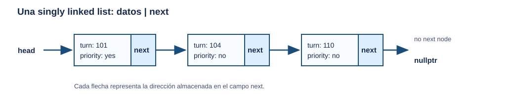
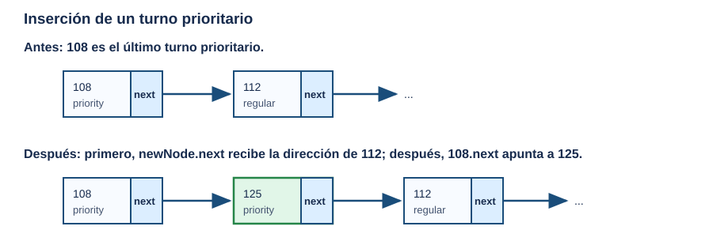
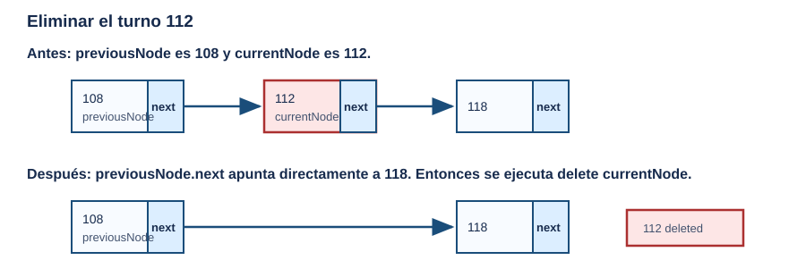
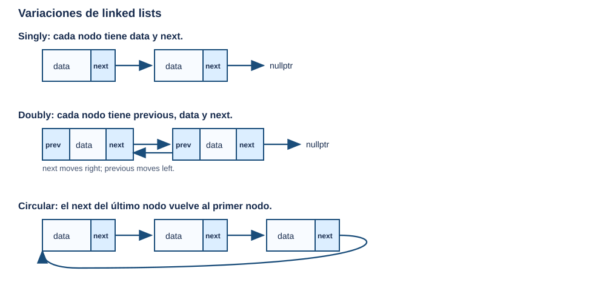

# Semana 9 — Linked Lists: Nodos, enlaces y colecciones dinámicas
## COEN 2220 — Programming 2

**Instructor:** Wilson Lozano

**Duración:** 170 min (sesión de 3 horas crédito nominales)  
**Precede a:** Lab 9 — Linked Lists  
**Lectura complementaria:** Gaddis, *Starting Out with C++*, 8va ed., Cap. 17 — secciones 17.1–17.4 (Linked List ADT, Linked List Operations, Linked List Template y Variations of the Linked List). La sección 17.5 se usa únicamente para una introducción breve a `std::list`; STL no será el mecanismo de implementación ni el foco de evaluación de esta unidad.

---

## Objetivos

Al finalizar la sesión, el estudiante podrá:

1. Explicar qué problema resuelve una linked list y cuándo un array continúa siendo una mejor elección.
2. Identificar los componentes de un nodo, el propósito de `head` y el significado de `nullptr` al final de una lista.
3. Construir y recorrer una singly linked list usando dynamic memory sin perder los enlaces entre nodos.
4. Implementar y justificar búsqueda lineal, llegada regular, inserción por prioridad y eliminación de un nodo.
5. Explicar por qué un destructor debe liberar cada nodo y reconocer el riesgo de copiar una clase que posee pointers.
6. Comparar singly, doubly y circular linked lists, y reconocer el uso básico de `std::list`.

## Parte 0 — Puente: del ADT y Big-O a una colección que crece (10 min)

En la Semana 6 definieron un **Abstract Data Type (ADT)**: primero se decide qué operaciones necesita el cliente de una colección y después se elige cómo implementarlas. En la Semana 8 añadieron una segunda pregunta: ¿cuánto trabajo requiere cada operación cuando crece `n`?

Hasta ahora, muchas colecciones se implementaron con arrays de capacidad fija. Por ejemplo, `FixedCollection` guardaba valores en posiciones consecutivas y necesitaba una capacidad definida de antemano. Esa decisión permite acceso directo por índice, pero plantea una pregunta práctica:

> Si Registraduría recibe una cantidad de personas que no conoce al inicio del día, ¿qué ocurre cuando el array de turnos se llena?

Una respuesta es escoger un array muy grande. Eso puede desperdiciar espacio y sigue imponiendo un límite artificial. Una **linked list** ofrece otra representación: crea un nodo dinámico cuando hace falta y conecta ese nodo con los que ya existen.

Una **linked list** es una colección lineal formada por objetos dinámicos llamados **nodes**. Cada nodo guarda un dato y la dirección del nodo que le sigue. Un pointer llamado `head` conserva la dirección del primer nodo; el último nodo no tiene otro después y su enlace vale `nullptr`. A diferencia de un array, los nodos no necesitan ocupar posiciones consecutivas en memoria: lo que mantiene el orden lógico es la cadena de pointers.

La lista no cambia el contrato fundamental de una colección. Un programa cliente todavía podría pedir operaciones como agregar un turno, buscar un turno, mostrar los turnos o remover a una persona que abandona la espera. Lo que cambia es la representación interna: en lugar de posiciones consecutivas, habrá nodos conectados mediante pointers.

> **Idea clave:** una linked list no es “un array mejor”. Es una estructura con costos y beneficios diferentes. La elección depende de las operaciones que el programa necesita realizar.

## Parte 1 — El problema y la decisión de diseño (15 min)

Ahora aplicaremos esa definición a un problema concreto. 
>La oficina de Registraduría del campus mantiene una linked list de turnos de espera para recibir servicios. Cada node representa a una persona con un número de turno y el enlace `next` conduce a la persona que sigue. Durante una hora tranquila puede haber pocos nodos; durante el período de matrícula la cantidad cambia constantemente.

Una persona sin prioridad se agrega al final de la espera. Una persona con prioridad —por ejemplo, una persona mayor o con discapacidad— debe ubicarse después de la última persona que ya tenía prioridad, antes de las personas sin prioridad. Si alguien abandona la espera, el sistema debe remover su nodo sin afectar los demás turnos.

Aunque este escenario tiene una espera, todavía no estudiaremos formalmente el **Queue ADT**. Una queue estricta atiende según *first in, first out*; la regla de prioridad modifica ese orden. En esta semana el foco es la linked list como representación interna. La semana próxima distinguirán formalmente entre la estructura enlazada y un ADT como stack o queue.

Un array y una linked list pueden almacenar números de turno, pero no se comportan igual:

| Necesidad | Array de capacidad fija | Singly linked list |
| --- | --- | --- |
| Saber cuántos elementos cabrán | Debe definirse una capacidad. | No se conoce de antemano; se crea un nodo cuando hace falta. |
| Consultar la posición 50 | Acceso directo por índice. | Se debe seguir `next` desde `head` hasta llegar a ese nodo. |
| Insertar entre dos elementos | Puede requerir mover elementos posteriores. | Una vez localizada la posición, se ajustan enlaces. |
| Remover entre dos elementos | Puede requerir mover elementos posteriores. | Una vez localizado el nodo anterior, se ajusta un enlace y se libera un nodo. |
| Memoria | Elementos consecutivos. | Nodos dinámicos que pueden estar en lugares distintos de memoria. |

La frase “una linked list inserta rápido” necesita una precisión importante: **reconectar enlaces** puede ser constante si ya se conoce la posición, pero **encontrar** esa posición normalmente exige comenzar en `head` y avanzar nodo por nodo hasta llegar a ella. No afirmaremos que una operación es rápida sin indicar qué información ya tiene el programa.

### Qué no resuelve automáticamente una linked list

Una linked list no elimina la necesidad de diseñar bien:

- Cada `new` debe corresponder a una liberación correcta de memoria.
- Un pointer mal actualizado puede desconectar nodos todavía necesarios.
- No existe acceso directo como `turns[50]`.
- Buscar por número de turno continúa siendo una búsqueda lineal en una singly linked list.

<details>
<summary>Pregunta de verificación: si el programa consulta repetidamente una posición conocida, ¿qué representación parece más conveniente?</summary>

Un array suele ser más conveniente porque su acceso por índice es directo. En una linked list habría que comenzar en `head` y avanzar nodo por nodo hasta esa posición.

</details>

## Parte 2 — Anatomía de una singly linked list (25 min)

Una linked list está formada por **nodes**. Cada nodo necesita dos tipos de información:

1. Los datos que el programa desea guardar. En este ejemplo, un `turnNumber` y si la persona tiene prioridad.
2. Un pointer que indica cuál es el nodo siguiente.

El siguiente `struct` describe un solo nodo; todavía no crea una lista ni reserva dynamic memory.

```cpp
struct Node
{
    int turnNumber;   // Store the visitor's turn number.
    bool hasPriority;  // Record whether the visitor has priority service.
    Node *next;        // Store the address of the next node.
};
```

La estructura se llama **self-referential** porque `next` puede almacenar la dirección de otro objeto del mismo tipo, `Node`. No contiene un `Node` completo dentro de sí mismo —eso nunca terminaría—; contiene un pointer a un posible `Node`.

Una lista con tres turnos puede visualizarse así:



`head` no es un nodo adicional. Es un pointer que mantiene la clase y que señala el primer nodo. Si la lista está vacía, no existe un primer nodo; por eso `head` debe valer `nullptr`.

Una lista vacía se representa simplemente como `head == nullptr`; no hay nodos creados ni enlaces que seguir.

### `.` y `->`: dos formas de acceder a members

Una variable declarada con `struct` también es una instancia u objeto de ese tipo. La diferencia importante aquí no es `struct` versus `class`, sino si trabajamos directamente con la instancia o con un pointer que guarda su dirección.

Si se declaró una instancia directamente, sin un pointer, se usa el operador `.`:

```cpp
Node localNode;               // Create a Node instance directly.
localNode.turnNumber = 101;  // Access a member through the instance.
```

En cambio, las variables que recorrerán la lista normalmente son pointers. Si `currentNode` guarda la dirección de un nodo, se usa `->`:

```cpp
Node *currentNode = nullptr;

// currentNode->turnNumber means (*currentNode).turnNumber.
```

La expresión `currentNode->turnNumber` es una forma compacta de escribir `(*currentNode).turnNumber`. Solo es válida si `currentNode` señala un nodo real. Intentar usar `->` cuando el pointer es `nullptr` es un error; por eso las condiciones de los loops verifican el pointer antes de acceder a sus members.

### Crear un nodo dinámicamente

Cuando llega una persona, la clase necesita reservar un nodo en memoria dinámica y preparar sus tres members.

```cpp
Node *newNode = new Node;   // Allocate one node dynamically.
newNode->turnNumber = 115;  // Store the turn number in the new node.
newNode->hasPriority = false; // Record the service priority.
newNode->next = nullptr;    // It does not point to another node yet.
```

Al declarar `Node *newNode;` solo se crea un pointer; no se crea un nodo. La expresión `new Node` es la que reserva el objeto dinámico. Inicializar `next` en `nullptr` es esencial: antes de conectarlo a una lista, sabemos que el nuevo nodo no apunta accidentalmente a otra dirección.

<details>
<summary>Pregunta de verificación: en el diagrama de tres turnos, ¿qué valor tiene <code>next</code> en el último nodo y por qué?</summary>

Tiene `nullptr`. Ese valor indica que no hay otro nodo después y permite que un traversal sepa cuándo detenerse.

</details>

## Parte 3 — Encapsular nodos y agregar al final (25 min)

Hasta ahora solo tenemos la descripción de **un** nodo. Pero el sistema necesita representar una **colección completa de turnos** y ofrecer operaciones sobre ella: agregar una persona, mostrar la espera, buscar un turno o remover a quien se retire. Para reunir los nodos y controlar esas operaciones, crearemos una clase llamada `ServiceTurnList`.

La clase necesita recordar dónde comienza su propia lista. Por eso tendrá un data member llamado `head`, de tipo `Node *`. `head` guardará la dirección del primer nodo o el valor `nullptr` cuando la lista esté vacía; no guarda un nodo completo, solo una dirección. Al crear un objeto `ServiceTurnList`, todavía no hay personas en espera, de modo que su constructor debe inicializar `head` en `nullptr`.

Los nodos y `head` determinan cómo está conectada la lista. Por esa razón pertenecen a `private`: el programa cliente solicitará operaciones como agregar, buscar o remover turnos, pero no podrá cambiar enlaces arbitrariamente. La parte esencial de esa declaración aparece así. El `struct Node` se declara primero porque `head` necesita conocer el tipo `Node`:

```cpp
private:
    struct Node
    {
        int turnNumber;   // Store one visitor turn number.
        bool hasPriority; // Record priority service status.
        Node *next;       // Link to the next node.
    };

    Node *head; // Store the first node address or nullptr.

public:
    ServiceTurnList()
    {
        head = nullptr; // Begin with no nodes in the list.
    }
```

Con la clase y su `head` definidos, podemos diseñar la primera operación que modifica la lista: agregar una persona sin prioridad al final.

Antes de escribir código, definamos con precisión qué debe hacer la operación `addRegularTurn`. Recibe un número de turno y debe dejar la lista en un estado válido: el nuevo nodo estará al final, su `next` será `nullptr` y el `next` del antiguo último nodo apuntará al nuevo. Si la lista estaba vacía, no hay antiguo último nodo: el nuevo nodo pasa a ser `head`.

Ese requisito se convierte en este proceso. No es necesario memorizarlo; cada paso corresponde a una necesidad de la representación enlazada:

1. Crear un nodo dinámico para la nueva persona e inicializar sus datos. Aún no forma parte de la lista.
2. Inicializar su `next` en `nullptr`, porque será el último nodo.
3. Si la lista está vacía, asignar `head = newNode` y terminar.
4. Si no está vacía, usar un pointer de trabajo para llegar al nodo cuyo `next` es `nullptr`.
5. Cambiar **ese** `next` para que apunte al nuevo nodo.

El siguiente ejemplo define una colección de turnos de Registraduría y codifica ese proceso. No intenten leer toda la clase como una sola idea: por ahora enfoquen `head`, el constructor y `addRegularTurn`. `display`, `contains`, inserción por prioridad y eliminación se desarrollarán en las partes siguientes.

```cpp
#include <iostream>
using namespace std;

class ServiceTurnList
{
private:
    struct Node
    {
        int turnNumber;  // Store one visitor turn number.
        bool hasPriority; // Record priority service status.
        Node *next;      // Link to the next node.
    };

    Node *head;       // Point to the first node or nullptr.

public:
    ServiceTurnList()
    {
        head = nullptr; // Start with an empty list.
    }

    ~ServiceTurnList();

    bool isEmpty() const
    {
        return head == nullptr; // An empty list has no first node.
    }

    void addRegularTurn(int newTurnNumber)
    {
        Node *newNode = new Node;
        newNode->turnNumber = newTurnNumber;
        newNode->hasPriority = false;
        newNode->next = nullptr;

        if (head == nullptr)
        {
            head = newNode; // The first node becomes the head.
            return;
        }

        Node *currentNode = head;

        while (currentNode->next != nullptr)
        {
            currentNode = currentNode->next; // Move toward the last node.
        }

        currentNode->next = newNode; // Link the old last node to the new node.
    }

    void display() const;
    bool contains(int targetTurnNumber) const;
    void addPriorityTurn(int newTurnNumber);
    bool removeByTurnNumber(int targetTurnNumber);
};
```

### Leer `addRegularTurn` como el proceso anterior

Las primeras cuatro líneas de `addRegularTurn` realizan los pasos 1 y 2: crean un nodo independiente, guardan los datos de la persona y ponen su `next` en `nullptr`. En ese momento existen dos objetos distintos: la lista original, señalada por `head`, y el nuevo nodo, señalado por `newNode`.

El `if` implementa el paso 3. Si `head` es `nullptr`, la lista no tiene primer nodo; por eso `head = newNode` es suficiente para crear una lista de un elemento. El `return` evita ejecutar el recorrido que solo tiene sentido cuando ya existen nodos.

Después del `if`, sabemos que `head` señala un nodo real. Entonces `currentNode` empieza en `head` y el `while` implementa el paso 4. La condición pregunta: “¿existe un nodo después del actual?” Cuando la respuesta es no, `currentNode` señala el último nodo. La última asignación implementa el paso 5. En este segundo caso no se modifica `head`: debe conservar la dirección del primer nodo durante toda la vida de la lista.

### Traza de `addRegularTurn(110)`

Supongan que ya existe esta lista:

```text
head --> [101 | priority: yes | next] --> [104 | priority: no | next] --> nullptr
```

1. `newNode` apunta al nodo dinámico `[110 | priority: no | nullptr]`.
2. `currentNode` comienza en el nodo `101`.
3. Como `101` tiene otro nodo después, `currentNode` avanza a `104`.
4. Ahora `104->next` es `nullptr`; `currentNode` está al final.
5. `currentNode->next = newNode` conserva los nodos existentes y agrega el nuevo enlace.

```text
head --> [101 | priority: yes | next] --> [104 | priority: no | next] --> [110 | priority: no | next] --> nullptr
```

> **Conexión con Big-O:** `addRegularTurn` no necesita recorrer nada si la lista está vacía, pero en una lista sin un `tail` pointer debe recorrer hasta el final. En el caso de más trabajo, eso depende de la cantidad de nodos: `O(n)`.

## Parte 4 — Traversal y búsqueda lineal (25 min)

Un **traversal** es el proceso de visitar nodos uno por uno, empezando en `head` y siguiendo `next` hasta llegar a `nullptr`. Es el patrón fundamental de una linked list. Mostrar datos, contar nodos y buscar un número de turno usan esta misma idea.

Antes de mostrar código, describamos el algoritmo de traversal. Se necesita un pointer de trabajo porque `head` no debe moverse: si se avanzara `head`, la clase olvidaría dónde comienza su lista. Por eso el método crea `currentNode` como una copia de `head` y repite tres acciones mientras `currentNode` no sea `nullptr`:

1. Procesar los datos del nodo actual.
2. Usar `currentNode->next` para obtener la dirección del siguiente nodo.
3. Guardar esa dirección en `currentNode` y volver a verificar si existe un nodo.

`display` usa ese algoritmo. Su “procesar” consiste en imprimir un turno:

En la Parte 3, la clase declaró `void display() const;` sin escribir todavía su cuerpo. Ahora aparece su **implementación fuera de la clase**. El prefijo `ServiceTurnList::` indica que esta función pertenece a esa clase; `const` promete que mostrar la lista no modificará `head`, los nodos ni sus datos.

```cpp
void ServiceTurnList::display() const
{
    Node *currentNode = head; // Begin at the first node.

    while (currentNode != nullptr)
    {
        cout << "Turn " << currentNode->turnNumber;

        if (currentNode->hasPriority)
        {
            cout << " (priority)";
        }

        cout << endl;                         // Finish one visitor line.
        currentNode = currentNode->next;      // Move to the next node.
    }
}
```

La línea que avanza `currentNode` no es opcional. Si el pointer nunca cambia, el loop se queda revisando el mismo nodo. Si avanza antes de procesar el dato, se omite el primer nodo. El orden correcto es: verificar que existe un nodo, procesarlo y avanzar al siguiente.

Por ejemplo, con los turnos `101 -> 104 -> 110`, el método sigue esta traza:

| Iteración | `currentNode` al comenzar | Acción | `currentNode` después de avanzar |
| --- | --- | --- | --- |
| 1 | nodo `101` | imprime `101` | nodo `104` |
| 2 | nodo `104` | imprime `104` | nodo `110` |
| 3 | nodo `110` | imprime `110` | `nullptr` |

La condición del `while` falla cuando `currentNode` es `nullptr`, así que no se intenta usar `currentNode->turnNumber` después del último nodo.

### Buscar un turno

El sistema también necesita saber si una persona con un número de turno dado continúa en espera. La operación `contains` conserva exactamente el mismo recorrido, pero cambia la acción del paso 1: en vez de imprimir, compara el número actual con el número solicitado. Si coinciden, ya tiene la respuesta y puede detenerse; si no, avanza al siguiente nodo.

En otras palabras, la búsqueda lineal no es un algoritmo separado y misterioso: es un traversal que hace una comparación en cada nodo hasta encontrar una coincidencia o llegar al final.

```cpp
bool ServiceTurnList::contains(int targetTurnNumber) const
{
    Node *currentNode = head;

    while (currentNode != nullptr)
    {
        if (currentNode->turnNumber == targetTurnNumber)
        {
            return true; // Stop because the requested turn was found.
        }

        currentNode = currentNode->next; // Continue with the next node.
    }

    return false; // Every node was checked without a match.
}
```

Por ejemplo, para buscar el turno `104` en la lista `101 -> 104 -> 110`, el método compara primero `101` y avanza. La segunda comparación coincide con `104`, por lo que ejecuta `return true` y termina de inmediato; no necesita revisar `110`.

| Estado de `currentNode` | Comparación | Decisión |
| --- | --- | --- |
| nodo `101` | `101 == 104` es falso | avanzar al nodo `104` |
| nodo `104` | `104 == 104` es verdadero | ejecutar `return true` |

Si se buscara `120`, ninguna comparación coincidiría. Después de revisar `110`, `currentNode` se convertiría en `nullptr`, el `while` terminaría y se ejecutaría `return false`. Así, los dos `return` responden dos resultados distintos del contrato de `contains`: encontró el turno o comprobó que no está en la lista.

Aunque los turnos con prioridad estén al inicio de la lista, esta estructura no permite saltar directamente al nodo central. Para llegar al supuesto “middle node”, primero habría que seguir enlaces desde `head`. Por eso la binary search que estudiaron con arrays no ofrece aquí el mismo beneficio. En el caso de más trabajo, `contains` es `O(n)`.

<details>
<summary>Pregunta de verificación: ¿por qué <code>currentNode = currentNode-&gt;next</code> no elimina el nodo actual?</summary>

Solo cambia el pointer de trabajo local para que señale otro nodo. Ningún enlace de la lista cambia y no se ejecuta `delete`; por tanto, la lista conserva todos sus nodos.

</details>

## Parte 5 — Inserción por prioridad: conservar el orden de atención (25 min)

La lista de Registraduría tiene una regla de negocio, no una regla numérica: las personas con prioridad se atienden antes que las personas sin prioridad. Sin embargo, entre personas de la misma categoría se conserva el orden de llegada.

Por eso, cuando llega una persona con prioridad, no siempre se coloca como el nuevo `head`. Debe ir **después de la última persona que ya tenía prioridad**. Si no existía ninguna persona prioritaria, se convierte en el primer nodo; si todas las personas actuales tienen prioridad, se agrega después de la última de ellas.

La operación debe manejar tres situaciones:

- la lista está vacía;
- el primer nodo no tiene prioridad, por lo que el nuevo nodo pasa a ser `head`;
- ya existe un bloque inicial de nodos prioritarios, por lo que el nuevo nodo se inserta justo después de ese bloque.

| Estado antes de la llegada | Dónde queda el nuevo turno prioritario | Razón |
| --- | --- | --- |
| Lista vacía | En `head` | Será el único nodo. |
| El primer nodo es regular | En `head`, antes del primer regular | Aún no existe un bloque prioritario. |
| Ya hay uno o más nodos prioritarios al inicio | Después del último prioritario | Conserva el orden de llegada entre personas prioritarias. |

Para implementar la tercera situación con seguridad, el programa no puede sobrescribir de inmediato `currentNode->next`: esa dirección podría ser el primer turno regular y se perdería la única ruta hacia el resto de la lista. El algoritmo correcto es:

1. Crear `newNode`, marcarlo prioritario y dejar su `next` inicialmente en `nullptr`.
2. Resolver los casos en que el nuevo nodo debe ser `head`.
3. Recorrer el bloque inicial de nodos prioritarios; al terminar, `currentNode` señala su último nodo.
4. Copiar el enlace que ya seguía a `currentNode` en `newNode->next`.
5. Hacer que `currentNode->next` apunte a `newNode`.

El orden de los pasos 4 y 5 es esencial: primero se conserva la dirección hacia el resto de la lista; después se instala el enlace nuevo.

```cpp
void ServiceTurnList::addPriorityTurn(int newTurnNumber)
{
    Node *newNode = new Node;
    newNode->turnNumber = newTurnNumber;
    newNode->hasPriority = true;
    newNode->next = nullptr;

    if (head == nullptr || !head->hasPriority)
    {
        newNode->next = head; // Preserve the old first regular visitor.
        head = newNode;       // The priority visitor becomes the first node.
        return;
    }

    Node *currentNode = head;

    while (currentNode->next != nullptr && currentNode->next->hasPriority)
    {
        currentNode = currentNode->next; // Stop at the last priority visitor.
    }

    newNode->next = currentNode->next; // Preserve the first regular visitor, if any.
    currentNode->next = newNode;       // Insert after the last priority visitor.
}
```

La condición del primer `if` usa `||`, que significa “o”. Si `head == nullptr` es verdadero, C++ ya sabe que la lista está vacía y no necesita —ni debe— evaluar `head->hasPriority`; intentar acceder a un member mediante un `nullptr` sería un error. Si la lista no está vacía, entonces sí evalúa `!head->hasPriority` para saber si el primer turno es regular.

El `while` usa `&&`, que significa “y”. Primero verifica `currentNode->next != nullptr`; solo si existe un nodo siguiente evalúa `currentNode->next->hasPriority`. Esto protege el acceso al pointer y evita consultar la prioridad de un nodo inexistente. Cuando el loop termina, `currentNode` quedó en el último nodo prioritario, no en el primer nodo regular.

### Traza de una llegada prioritaria

Supongan que llega el turno `125` con prioridad y la lista contiene dos personas prioritarias y dos regulares:

```text
head --> [101 | priority: yes] --> [108 | priority: yes] --> [112 | priority: no] --> [118 | priority: no] --> nullptr
```

El loop coloca `currentNode` en el turno `108`, que es la última persona prioritaria. `newNode->next` conserva el enlace hacia `112`; luego `currentNode->next` enlaza `108` con `125`.

```text
head --> [101 | priority: yes] --> [108 | priority: yes] --> [125 | priority: yes] --> [112 | priority: no] --> [118 | priority: no] --> nullptr
```

La prioridad no significa saltar por delante de personas que ya tenían la misma prioridad. Esa decisión conserva un orden justo dentro de cada categoría.

El cambio de enlaces puede verse de esta forma. Arriba está la lista antes de la llegada; abajo, los enlaces después de insertar `125`. El nuevo nodo queda entre el último turno prioritario y el primer turno regular.



> **Nota de diseño:** localizar el final del bloque prioritario puede requerir recorrer nodos, así que `addPriorityTurn` es `O(n)` en el peor caso. Una vez localizada la posición, ajustar los dos enlaces toma trabajo constante.

## Parte 6 — Remover nodos y liberar toda la lista (25 min)

Si una persona decide abandonar la espera, el sistema debe remover su turno. Como el programa cliente necesita saber si la solicitud tuvo éxito, `removeByTurnNumber` devuelve un `bool`: devuelve `true` cuando encontró y removió el turno; devuelve `false` cuando la lista estaba vacía o el turno no aparece en ella.

Eliminar un nodo requiere dos responsabilidades distintas:

1. Reconectar la lista para que ningún enlace siga apuntando al nodo que se removerá.
2. Liberar la memoria dinámica del nodo con `delete`.

La expresión `delete somePointer;` libera el objeto dinámico al que señala `somePointer`. Después de `delete`, ese pointer no debe usarse para acceder a members del nodo que se liberó. Si se ejecutara `delete` antes de guardar o actualizar los enlaces necesarios, se perdería la información para mantener la lista válida.

Por eso el método trabaja con dos pointers durante el recorrido: `previousNode` señala el nodo anterior y `currentNode` señala el nodo que se está examinando. Mantener ambos permite que, al encontrar el turno, el nodo anterior salte sobre el nodo que debe salir.

El proceso completo es el siguiente:

1. Si `head` es `nullptr`, no hay nada que remover.
2. Si el turno buscado está en `head`, mover `head` al segundo nodo, guardar el antiguo primer nodo y liberarlo.
3. Para los demás casos, iniciar `previousNode` en `head` y `currentNode` en el segundo nodo; avanzar ambos pointers juntos hasta encontrar el turno o terminar la lista.
4. Si se encontró, asignar `previousNode->next = currentNode->next`. Ahora la cadena ya no contiene `currentNode`.
5. Solo entonces ejecutar `delete currentNode`.

El código siguiente implementa esos cinco pasos:

```cpp
bool ServiceTurnList::removeByTurnNumber(int targetTurnNumber)
{
    if (head == nullptr)
    {
        return false; // There is no node to remove.
    }

    if (head->turnNumber == targetTurnNumber)
    {
        Node *nodeToDelete = head;
        head = head->next; // Move head before deleting the old first node.
        delete nodeToDelete;
        return true;
    }

    Node *previousNode = head;
    Node *currentNode = head->next;

    while (currentNode != nullptr && currentNode->turnNumber != targetTurnNumber)
    {
        previousNode = currentNode;
        currentNode = currentNode->next;
    }

    if (currentNode == nullptr)
    {
        return false; // The requested turn does not exist in the list.
    }

    previousNode->next = currentNode->next; // Bypass the node to remove.
    delete currentNode;                      // Release its dynamic memory.
    return true;
}
```

El caso del primer nodo debe tratarse por separado porque no existe un nodo anterior. Para un nodo del medio o final, `previousNode->next = currentNode->next` hace que el nodo anterior apunte directamente al nodo siguiente. Solo después es seguro ejecutar `delete currentNode`.

Por ejemplo, para remover `112` de `101 -> 108 -> 112 -> 118`, los dos pointers avanzan juntos hasta que `currentNode` llega al turno buscado:

| Momento | `previousNode` | `currentNode` | ¿Se encontró `112`? |
| --- | --- | --- | --- |
| Inicio del recorrido | `101` | `108` | No |
| Después de una vuelta | `108` | `112` | Sí |

En ese punto, `previousNode->next = currentNode->next` hace que `108` apunte a lo que seguía después de `112`: el turno `118`. Así `112` queda fuera de la lista antes de liberarlo.

Por ejemplo, si se elimina el turno `112`, el programa primero conecta el nodo anterior con el nodo siguiente. El nodo `112` queda fuera de la cadena y entonces puede liberarse.



### Destructor: la clase es responsable de todos sus nodos

`ServiceTurnList` creó nodos con `new`; por tanto, su destructor debe eliminarlos cuando el objeto lista deje de existir. Un destructor es un member function especial cuyo nombre comienza con `~`; C++ lo llama automáticamente al terminar la vida de un objeto, por ejemplo, cuando una variable local sale de su scope. No se llama manualmente en el flujo normal del programa.

El destructor aplica el mismo patrón de traversal, pero con una precaución adicional. En cada vuelta debe (1) guardar la dirección del nodo siguiente, (2) liberar el nodo actual y (3) avanzar usando la dirección que guardó. No puede pedir `currentNode->next` después de liberar `currentNode`, porque ese objeto ya no existe.

```cpp
ServiceTurnList::~ServiceTurnList()
{
    Node *currentNode = head;

    while (currentNode != nullptr)
    {
        Node *nextNode = currentNode->next; // Save the next address before delete.
        delete currentNode;                 // Release the current node.
        currentNode = nextNode;             // Continue with the saved next node.
    }

    head = nullptr; // Leave the list in an explicitly empty state.
}
```

`nextNode` existe porque, después de `delete currentNode`, ya no es válido leer `currentNode->next`. La dirección del siguiente nodo debe guardarse **antes** de liberar el nodo actual.

### Conexión con copies de Semana 4

Esta versión introductoria de `ServiceTurnList` posee dynamic memory. Por esa razón, no se debe copiar con el copy constructor o con assignment generado automáticamente. Una copia superficial haría que dos listas compartieran los mismos nodos, y ambos destructores intentarían liberar las mismas direcciones.

Resolver correctamente ese problema requiere un copy constructor y un assignment operator que creen nodos independientes. Ese diseño se conoce como parte de la *Rule of Three* y queda fuera de la implementación inicial de esta semana. La conexión importante es recordar que copiar una clase con pointers propietarios exige una decisión explícita; no se comporta como copiar solo `int` y `string`.

## Parte 7 — Variaciones: doubly y circular linked lists (10 min)

Hasta ahora, hemos usado una **singly linked list** porque el problema solo exigía avanzar desde el primer turno hacia el siguiente. Cada nodo solo conoce el siguiente nodo.

Pero una representación debe responder a las operaciones que el programa necesita. Si el personal de Registraduría tuviera que moverse repetidamente hacia atrás desde un turno actual, una singly linked list no ofrece ese enlace. En una **doubly linked list**, cada nodo guarda dos enlaces:

El enlace `previous` permite recorrer hacia atrás y puede facilitar ciertas eliminaciones cuando ya se tiene una referencia al nodo. A cambio, cada inserción y eliminación debe actualizar cuidadosamente hasta cuatro enlaces, y cada nodo consume espacio adicional. No basta con “agregar un pointer”: ahora cada operación debe mantener coherentes tanto `next` como `previous`.

En una **circular linked list**, el último nodo no contiene `nullptr` en `next`; apunta de nuevo al primero. Esta estructura puede servir, por ejemplo, para rotar repetidamente entre estaciones de servicio. Sin embargo, un traversal no puede esperar encontrar `nullptr`: debe detenerse al regresar al nodo donde comenzó o después de visitar una cantidad conocida de nodos. De otro modo, el loop sería infinito.

El siguiente diagrama compara qué pointers tiene cada nodo. Las flechas siempre salen de los campos `next` o `previous`; por eso se observa qué recorrido permite cada representación.



| Tipo | Enlace final | Ventaja principal | Responsabilidad adicional |
| --- | --- | --- | --- |
| Singly | `nullptr` | Menos enlaces por nodo. | Solo se puede avanzar. |
| Doubly | El `next` del último nodo es `nullptr`; cada nodo también guarda `previous`. | Recorrido hacia ambos lados. | Mantener ambos enlaces correctos. |
| Circular | El `next` del último nodo vuelve al primer nodo. | Recorrido cíclico. | Detener el traversal sin esperar `nullptr`. |

Por ahora, la singly linked list es la mejor base para dominar la lógica de enlaces y ownership de memoria.

No implementarán todavía estas dos variaciones. El objetivo de compararlas aquí es aprender a preguntar primero qué recorridos y operaciones necesita el problema; solo entonces se escoge la estructura cuyos enlaces hacen posibles esas operaciones.

## Parte 8 — Reconocer y usar `std::list` (10 min)

Hasta ahora implementaron la representación manual para comprender qué hace realmente una linked list: crear nodos, conservar `head`, actualizar `next` y liberar memoria. En un programa profesional, el problema puede requerir una colección con operaciones semejantes sin que el programador tenga que administrar esos detalles internos cada vez.

La Standard Template Library ofrece `std::list`, un contenedor generalmente implementado como una doubly linked list. Al usarlo, el programador trabaja con operaciones como agregar, consultar o recorrer; la biblioteca crea y libera sus nodos internos. Conocer `std::list` permite leer y usar código existente, aunque la implementación manual siga siendo el foco de esta unidad.

### Ejemplo 1: crear y agregar elementos

El primer ejemplo representa una espera simple. `list<int>` indica que cada elemento será un número de turno. Se agregan dos turnos regulares al final y uno al frente; luego se consulta el primero, el último y la cantidad total. No hay `Node`, `head` ni `delete` visibles porque `std::list` los encapsula.

```cpp
#include <iostream>
#include <list>
using namespace std;

int main()
{
    list<int> turnNumbers;

    turnNumbers.push_back(104);  // Add a regular turn at the end.
    turnNumbers.push_back(110);  // Add another regular turn.
    turnNumbers.push_front(101); // Add a turn at the beginning.

    cout << "First turn: " << turnNumbers.front() << endl;
    cout << "Last turn: " << turnNumbers.back() << endl;
    cout << "Turn count: " << turnNumbers.size() << endl;

    return 0;
}
```

`std::list<int>` expresa que el contenedor guardará valores `int`. `push_front` y `push_back` comunican claramente dónde se agregará cada valor; el programador no declara `Node`, no actualiza `head` y no ejecuta `delete` sobre nodos internos.

La salida esperada es:

```text
First turn: 101
Last turn: 110
Turn count: 3
```

### Ejemplo 2: recorrer y remover por valor

El segundo ejemplo muestra una diferencia importante entre una operación de biblioteca y la operación manual `removeByTurnNumber`: `std::list::remove(value)` compara valores almacenados y elimina **todas** las apariciones iguales. La lista contiene dos valores `104`; después de `remove(104)`, solo deben quedar `101` y `110`.

```cpp
#include <iostream>
#include <list>
using namespace std;

int main()
{
    list<int> turnNumbers;

    turnNumbers.push_back(101); // Add the first dummy turn number.
    turnNumbers.push_back(104); // Add a value that appears twice.
    turnNumbers.push_back(110); // Add another turn number.
    turnNumbers.push_back(104); // Add the repeated value.

    turnNumbers.remove(104); // Remove every node whose value equals 104.

    for (int turnNumber : turnNumbers)
    {
        cout << turnNumber << endl; // Process one stored turn number at a time.
    }

    return 0;
}
```

El range-based loop recorre los elementos sin usar índices. También es importante leer con precisión la documentación de una operación: en este ejemplo, `remove(104)` elimina **todos** los valores iguales a `104`, no solo el primero.

La salida esperada es:

```text
101
110
```

> **Alcance de COEN 2220:** estos ejemplos existen para reconocer `std::list` y usar operaciones básicas. El Lab 9 y las evaluaciones de linked lists se concentrarán en la implementación manual, porque allí se aprende qué trabajo está encapsulando la biblioteca.

## Resumen de la sesión

- Una linked list representa una colección como nodos dinámicos conectados; `head` señala el primero y `nullptr` señala el final de una singly linked list.
- `->` accede a un member mediante un pointer; solo se usa cuando el pointer señala un nodo válido.
- Traversal es el patrón de avanzar de `head` a `nullptr`. Mostrar, contar y buscar usan este patrón.
- La inserción por prioridad preserva el orden de llegada dentro de cada categoría; la eliminación requiere conservar referencias antes de cambiar enlaces o liberar memoria.
- Un destructor libera cada nodo creado dinámicamente; una lista con pointers propietarios no se debe copiar superficialmente.
- Doubly y circular linked lists cambian los enlaces disponibles y también las responsabilidades de mantenimiento.
- `std::list` ofrece una alternativa de biblioteca, pero comprender la implementación manual permite justificar sus costos y depurar estructuras enlazadas.

## Próxima sesión

En el Lab 9 aplicarán estos conceptos para construir y probar una singly linked list. La meta no será memorizar líneas de código: será poder dibujar qué pointers cambian antes de escribir una operación que agregue, encuentre, inserte o remueva un nodo.
